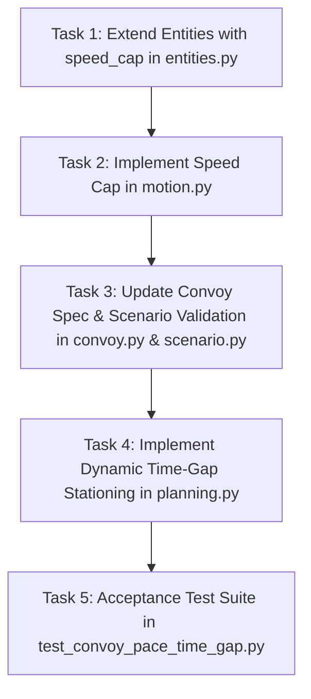

# Implementation Plan - Issue #10: Convoy Pace and Time Gap

**Parent Roadmap**: Phase 1: Straight Road Movement & Doctrine Arithmetic  
**Target Issue**: [Issue #10: Convoy: pace and time gap](https://github.com/VadimSokolov/sandtable/issues/10)  
**Branch**: `issue-10-convoy-pace-time-gap` -> `convoy-dev`  
**Doctrinal References**: ATP 4-16 (Movement Control, App. C), ATP 4-11 (App. G & App. M), FM 4-0  

---

## 1. Doctrinal Motivation and Problem Statement

In military convoy operations (ATP 4-16, C-4 to C-6), movement along a route is governed by two fundamental quantities:
1. **Pace**: The regulated speed of the column or element, set by the **pacesetter vehicle** (the lead vehicle of the column or march unit). The pacesetter maintains a steady, controlled speed below the platform's maximum mechanical speed so that following vehicles can surge to close gaps without breaking formation or causing string instability.
2. **Time Gap**: The time interval between successive vehicles or elements passing a given point. Rather than maintaining a fixed distance in meters regardless of speed, modern doctrine and autonomous transport systems (ATP 4-11, App. M) define inter-vehicle separation as a **time gap** ($t_{\text{gap}}$):
   $$\text{separation}(v) = \max(\text{min\_gap}, v \times t_{\text{gap}})$$
   - At high speed, separation expands to preserve reaction and braking time.
   - At low speed or halts, separation compresses down to a minimum standoff distance (`min_gap`) to prevent vehicle collisions while conserving road space.

Currently in SandTable:
- Entities advance at `min(max_speed * tempo * traffic, dist / dt)` without a regulated pace.
- Follower vehicles station at a rigid spatial offset: $\text{rank} \times \text{formation\_spread}$, regardless of vehicle speed.

---

## 2. Mathematical Specification

### A. Regulated Pace and Speed Cap
In `src/sandtable/motion.py`, each vehicle's commanded speed $v_i$ is subject to a per-vehicle speed cap:
$$v_i = \min(v_{\text{commanded}}, \text{speed\_cap}_i, \frac{\text{dist}_i}{\Delta t})$$
- **Pacesetter / Lead Vehicles (`role == 0` or Column Head)**: When `pace` is specified in `convoy` parameters, $\text{speed\_cap} = \text{pace}$.
- **Follower Vehicles (`role == 1`)**: Allowed a surge buffer to maintain station (capped at platform `max_speed` or an optional catchup ceiling $\min(\text{max\_speed}, \text{pace} \times 1.25)$).
- **Default (Pace Off)**: $\text{speed\_cap} = \infty$ (or `None`), leaving motion completely unconstrained and byte-identical to existing baseline.

### B. Time-Distance Stationing
In `src/sandtable/planning.py`, follower target calculation is updated:
$$\text{effective\_gap}(v) = \max(\text{gap}_{\text{min}}, v \times t_{\text{gap}})$$
- For star topology relative to march unit head:
  $$\text{offset}_i = \text{rank}_i \times \text{effective\_gap}(v_{\text{ref}})$$
  where $\text{rank}_i = i - \text{leader}_i$, and $v_{\text{ref}}$ is the tracked speed of the lead vehicle.
- For chain topology relative to immediate predecessor:
  $$\text{offset}_i = 1 \times \text{effective\_gap}(v_{\text{ref}})$$
- When $t_{\text{gap}} = 0$ or is unspecified, $\text{effective\_gap} = \text{gap}_{\text{min}}$, reproducing the exact byte-identical static distance $\text{rank} \times \text{gap}$.

### C. Inter-Element Time Gap
Between successive March Units within a Serial:
- The lead vehicle of March Unit $m > 0$ can observe an inter-element time gap ($T_{\text{element}}$) behind the trail vehicle of March Unit $m - 1$, preventing element overlap.

---

## 3. Step-by-Step Implementation Tasks



### Task 1: Extend `Entities` Dataclass
**Target File**: `src/sandtable/entities.py`
1. Add optional attribute:
   ```python
   speed_cap: np.ndarray = None  # float: maximum allowed speed (m/s) or inf
   ```
2. In `Entities.__post_init__`, default when None:
   ```python
   if self.speed_cap is None:
       self.speed_cap = np.full(n, np.inf)
   ```

### Task 2: Enforce Speed Cap in Motion Kinematics
**Target File**: `src/sandtable/motion.py`
1. In `motion.step(ent, world, dt, tempo)`:
   - Apply per-vehicle speed cap:
     ```python
     if ent.speed_cap is not None:
         v = np.minimum(v, ent.speed_cap)
     ```
   - Ensure byte-identity when `ent.speed_cap` is `inf` or `None`.

### Task 3: Convoy Spec Extensions
**Target Files**: `src/sandtable/convoy.py`, `src/sandtable/scenario.py`
1. In `convoy.py`:
   - Extend `validate_convoy_spec(spec)` to accept:
     - `pace`: optional float in $(0, 50.0]$ m/s.
     - `time_gap`: optional float in $(0, 60.0]$ seconds.
     - `element_time_gap`: optional float in $(0, 300.0]$ seconds.
2. In `scenario.py` (`build_entities`):
   - When `pace` is provided in `scn.params["convoy"]`:
     - Assign `e.speed_cap[i] = pace` for march unit heads (`e.role == 0`).
     - Followers retain `e.speed_cap[i] = e.max_speed[i]` (or surge allowance).

### Task 4: Dynamic Time-Gap Follower Stationing
**Target File**: `src/sandtable/planning.py`
1. In `_behavior_targets`:
   - Retrieve `time_gap` from `scn.params.get("convoy", {}).get("time_gap")` or `scn.params.get("time_gap")`.
   - Compute `effective_gap = max(gap, v * time_gap)` when `time_gap` is present.
   - Use `effective_gap` in follower target offset computation.

### Task 5: Acceptance Test Suite
**Target File**: `tests/test_convoy_pace_time_gap.py`
1. `test_pace_time_gap_off_is_byte_identical`:
   - Verify absent pace/time_gap produces identical runs across seeds.
2. `test_steady_pace_regulation`:
   - Verify lead vehicle speed equals declared `pace` during open transit.
3. `test_time_gap_dynamic_expansion`:
   - Verify follower station expands linearly with speed and maintains `time_gap` within $\pm 1$ timestep (`dt`).
4. `test_doctrinal_bounds_pace_and_gap`:
   - Verify invalid/negative pace or extreme time gap raises `ValueError`.

---

## 4. Acceptance Criteria

- **AC-1 (Byte-Identity)**: Scenarios without `pace` or `time_gap` behave 100% byte-identically to `main`.
- **AC-2 (Speed Regulation)**: Pacesetter vehicle speed matches declared `pace` within floating point precision when unconstrained by terrain.
- **AC-3 (Time Gap Precision)**: Measured passage time gap between successive vehicles is within 1 timestep of declared $t_{\text{gap}}$.
- **AC-4 (Clean Code & Tests)**: All tests pass, `ruff check` returns 0 errors, no em dashes in code or commits.
