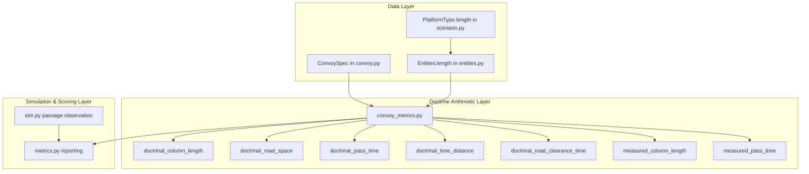
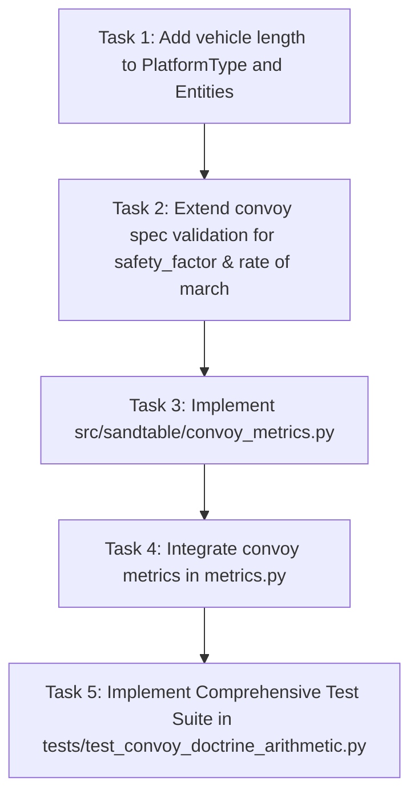

# Implementation Plan - Issue #11: Convoy Doctrine Arithmetic (ATP 4-16)

**Parent Roadmap**: Phase 1: Straight Road Movement & Doctrine Arithmetic  
**Target Issue**: [Issue #11: Convoy: doctrine arithmetic from ATP 4-16 (column length, road space, pass time, time gap)](https://github.com/VadimSokolov/sandtable/issues/11)  
**Branch**: `issue-11-convoy-doctrine-arithmetic` -> `convoy-dev`  
**Doctrinal References**: ATP 4-16 (Movement Control, April 2022, App. C), ATP 4-11 (Army Motor Transport Operations, March 2026, App. G & M), FM 4-0 (Sustainment Operations, March 2026)  

---

## 1. Doctrinal Motivation and Problem Statement

In U.S. Army doctrine, tactical road march planning and movement control are governed by standardized mathematical identities defined in **ATP 4-16 (Appendix C, Movement Computations)**. Military movement control officers and convoy commanders rely on these formulas to schedule road networks, avoid convoy collisions, deconflict choke points, and allocate road capacity:

1. **Column Length ($CL$)**: The physical extent of road occupied by a column from the front bumper of the lead vehicle to the rear bumper of the trail vehicle, including all physical vehicle lengths, intra-element gaps, and inter-element gaps.
2. **Road Space ($RS$)**: The total road length reserved for a column, defined as column length plus an operational safety margin ($CL + \text{safety\_buffer}$).
3. **Pass Time ($PT$)**: The elapsed time required for a column or element to pass a single given point on the route, determined by its column length and regulated pace / rate of march ($CL / v$).
4. **Time Distance ($TD$)**: The time required for a vehicle (or the head of the column) to travel between an origin (Start Point / SP) and a destination (Release Point / RP) over route distance $D$ ($D / v$).
5. **Road Clearance Time ($RCT$)**: The total duration a route or segment is occupied from lead vehicle departure until the trail vehicle clears the release point ($RCT = TD + PT$).
6. **Time Gap ($\Delta t$)**: The time interval between successive vehicles or march elements passing a stationary point ($\Delta t = G / v$).

### The Contested Logistics Tradeoff
As noted in `doc/contested_logistics_one_pager.md` and FM 4-0 (1-46), dispersed operations enhance survivability against aerial observation and precision strikes but consume substantial road space and prolong road clearance time. ATP 4-11 (para G-9) explicitly articulates this tension:
- Keeping march units large reduces inter-element gaps, maximizing road-space efficiency and minimizing pass time.
- Splitting into smaller march units and serials with large time gaps reduces vulnerability to mass-casualty strikes, but inflates column length, road space, and pass time.

In SandTable, we must implement these exact ATP 4-16 calculations in a dedicated module `src/sandtable/convoy_metrics.py` (standing beside `formation_metrics.py`) and equip platforms with physical vehicle lengths (`PlatformType.length`). The test suite will verify that the foundational ATP 4-16 identities hold on constructed and simulated columns.

---

## 2. Mathematical Specification

### A. Core Doctrinal Definitions & Nomenclature
Let:
- $N$: Total number of vehicles in the column.
- $L_{v, i}$: Physical length of vehicle $i$ from front bumper to rear bumper (meters).
- $v_{pace}$: Regulated speed set by the pacesetter (m/s).
- $v_{march}$: Rate of march (average speed including scheduled halts, m/s). When no halts are scheduled, $v_{march} = v_{pace}$.
- $G_{intra}$: Intra-element gap between successive vehicles within the same march unit (meters).
- $G_{unit}$: Inter-element gap between successive march units within a serial (meters).
- $G_{serial}$: Inter-element gap between successive serials (meters).
- $s_f$: Safety factor buffer fraction ($s_f \ge 0$, e.g. 0.1 for a 10% safety margin).
- $D$: Route distance from Start Point (SP) to Release Point (RP) / Destination (meters).

---

### B. Column Length ($CL$)
Column length is the distance from the front bumper of the lead vehicle to the rear bumper of the trail vehicle:
$$CL = \sum_{i=1}^{N} L_{v, i} + \sum_{k=1}^{N-1} G_k$$
where $G_k$ is the spacing between the rear bumper of vehicle $k$ and the front bumper of vehicle $k+1$.

For a standard convoy organized into $S$ serials, each containing $M$ march units, with $K$ vehicles per march unit (total $N = S \times M \times K$ vehicles):
- Total intra-march-unit gaps: $N_{intra} = S \times M \times (K - 1)$
- Total inter-march-unit gaps (within serials): $N_{unit} = S \times (M - 1)$
- Total inter-serial gaps: $N_{serial} = S - 1$

When vehicles share a uniform length $L_v$:
$$CL = N \cdot L_v + N_{intra} \cdot G_{intra} + N_{unit} \cdot G_{unit} + N_{serial} \cdot G_{serial}$$

When gaps are governed by time gaps ($t_{gap}$, $t_{element\_gap}$, $t_{serial\_gap}$) at pace $v_{pace}$:
$$G_{intra} = \max(\text{min\_gap}, v_{pace} \times t_{gap})$$
$$G_{unit} = \max(\text{min\_gap}, v_{pace} \times t_{element\_gap})$$
$$G_{serial} = \max(\text{min\_gap}, v_{pace} \times t_{serial\_gap})$$

---

### C. Road Space ($RS$)
In doctrine (ATP 4-16, C-5), road space is column length plus a safety buffer or factor:
$$RS = CL \times (1 + s_f) \quad \text{or} \quad RS = CL + \text{safety\_margin}$$
When $s_f = 0$, $RS = CL$.

---

### D. Pass Time ($PT$)
Pass time is the duration required for the entire column (from lead front bumper to trail rear bumper) to pass a fixed reference point on the route:
$$PT = \frac{CL}{v_{march}}$$
When halts are absent on the move, $v_{march} = v_{pace}$, so:
$$PT = \frac{CL}{v_{pace}}$$

---

### E. Time Distance ($TD$)
Time distance is the duration required for a single vehicle (or the front bumper of the lead vehicle) to travel route distance $D$:
$$TD = \frac{D}{v_{march}} = \frac{D}{v_{pace}}$$

---

### F. Road Clearance Time ($RCT$)
Road clearance time is the total time a route segment is occupied from the instant the lead vehicle departs/enters the segment until the trail vehicle clears the exit:
$$RCT = TD + PT = \frac{D + CL}{v_{march}}$$

---

### G. The Five ATP 4-16 Core Doctrinal Identities
The implementation and acceptance tests are grounded in verifying these five invariant identities:
1. **Time-Distance-Rate Identity**:
   $$TD \times v_{march} = D$$
2. **Pass Time Identity**:
   $$PT \times v_{march} = CL$$
3. **Road Clearance Time Sum Identity**:
   $$RCT = TD + PT$$
4. **Road Space Expansion Identity**:
   $$RS = CL \times (1 + s_f)$$
5. **Route Clearance Equivalence Identity**:
   $$RCT \times v_{march} = D + CL$$

---

## 3. Architecture & Data Structures



### A. Extend `PlatformType` and `Entities`
In [`src/sandtable/scenario.py`](file:///Users/markfahim/Work/GRA%20GM/sandtable/src/sandtable/scenario.py):
- Add `length: float = 6.0` to `PlatformType`.
- Default: `6.0` meters (representative length for standard tactical cargo truck / PLS / UGV; `0.0` for air platforms).
- Existing JSON scenarios without an explicit `"length"` field will automatically receive the default `6.0` without any schema breaking changes.

In [`src/sandtable/entities.py`](file:///Users/markfahim/Work/GRA%20GM/sandtable/src/sandtable/entities.py):
- Add `length: np.ndarray = None` to `Entities`.
- In `Entities.allocate(n)`, initialize `length=z()`.
- In `Entities.__post_init__`, default when None: `self.length = np.full(n, 6.0)`.
- In `scenario.build_entities`, assign `e.length[i] = pt.length`.

### B. Extend Convoy Specification Validation
In [`src/sandtable/convoy.py`](file:///Users/markfahim/Work/GRA%20GM/sandtable/src/sandtable/convoy.py):
- In `validate_convoy_spec(spec)`:
  - Add optional `safety_factor`: float in $[0.0, 1.0]$ (default 0.0 or 0.1).
  - Add optional `halt_duration`: float in $[0.0, 3600.0]$ s (or scheduled halt fraction).
  - Add optional `serial_time_gap`: float in $(0, 600.0]$ s (time gap between serials, defaulting to `element_time_gap`).

---

## 4. Module Specification: `src/sandtable/convoy_metrics.py`

This module sits alongside `formation_metrics.py` and provides both:
1. **Analytical (Doctrinal) Calculators**: Pure functions computing planned ATP 4-16 quantities directly from parameters.
2. **Empirical (Simulated) Trace Estimators**: Functions measuring column length, pass time, and road clearance time from simulated agent kinematics.
3. **Identity Verification**: Built-in verification checking that the ATP 4-16 identities hold within floating-point tolerance.

### Exported Functions in `convoy_metrics.py`:
- `doctrinal_column_length(spec: dict, platform_lengths: list[float] | float = 6.0, default_spacing: float = 30.0) -> float`
  - Returns $CL$ in meters.
- `doctrinal_road_space(column_length: float, safety_factor: float = 0.0) -> float`
  - Returns $RS = CL \times (1 + s_f)$.
- `doctrinal_rate_of_march(pace: float, halt_duration: float = 0.0, march_duration: float = 3600.0) -> float`
  - Returns $v_{march}$ in m/s.
- `doctrinal_pass_time(column_length: float, pace: float) -> float`
  - Returns $PT = CL / v_{pace}$ in seconds.
- `doctrinal_time_distance(distance: float, pace: float) -> float`
  - Returns $TD = D / v_{pace}$ in seconds.
- `doctrinal_road_clearance_time(time_distance: float, pass_time: float) -> float`
  - Returns $RCT = TD + PT$ in seconds.
- `doctrinal_convoy_summary(spec: dict, route_distance: float, platform_length: float = 6.0, default_spacing: float = 30.0) -> dict`
  - Returns a unified dictionary containing:
    ```python
    {
        "column_length": cl,
        "road_space": rs,
        "pace": pace,
        "rate_of_march": rom,
        "pass_time": pt,
        "time_distance": td,
        "road_clearance_time": rct,
        "safety_factor": safety_factor,
        "total_vehicles": total_vehicles,
    }
    ```
- `verify_atp416_identities(summary: dict, route_distance: float, tol: float = 1e-6) -> bool`
  - Checks:
    1. $|TD \cdot v_{march} - D| < tol$
    2. $|PT \cdot v_{march} - CL| < tol$
    3. $|RCT - (TD + PT)| < tol$
    4. $|RS - CL \cdot (1 + s_f)| < tol$
    5. $|RCT \cdot v_{march} - (D + CL)| < tol$
- `measured_column_length(x: np.ndarray, y: np.ndarray, lengths: np.ndarray | float = 6.0, mask: np.ndarray | None = None) -> float`
  - Computes empirical column length along the primary axis of march from the front bumper of the lead vehicle to the rear bumper of the trail vehicle.
- `class PassageRecorder`:
  - Tracks vehicles crossing an observation line perpendicular to the march route to empirically measure:
    - `t_head`: Time lead front bumper crosses line.
    - `t_trail`: Time trail rear bumper crosses line.
    - `pass_time = t_trail - t_head`.
    - `time_gaps`: Measured inter-vehicle time gaps.

---

## 5. Integration into `metrics.py` and `sim.py`

In [`src/sandtable/metrics.py`](file:///Users/markfahim/Work/GRA%20GM/sandtable/src/sandtable/metrics.py):
- In `compute(...)`:
  - Check if `scn.params.get("convoy")` is present and active for blue ground forces.
  - When present, invoke `convoy_metrics.doctrinal_convoy_summary` with route distance:
    $$D = \|\text{goal} - \text{spawn}\|$$
  - Include the following KPIs in the returned dictionary:
    - `"convoy_column_length"`: doctrinal $CL$ (m)
    - `"convoy_road_space"`: doctrinal $RS$ (m)
    - `"convoy_pass_time"`: doctrinal $PT$ (s)
    - `"convoy_time_distance"`: doctrinal $TD$ (s)
    - `"convoy_road_clearance_time"`: doctrinal $RCT$ (s)
  - When `scn.params.get("convoy")` is absent or None, do NOT add these fields, ensuring 100% byte-identity for all non-convoy scenarios.

---

## 6. Implementation Tasks



### Task 1: Add Physical Vehicle Length
- **Files**: [`src/sandtable/scenario.py`](file:///Users/markfahim/Work/GRA%20GM/sandtable/src/sandtable/scenario.py), [`src/sandtable/entities.py`](file:///Users/markfahim/Work/GRA%20GM/sandtable/src/sandtable/entities.py)
- Add `length: float = 6.0` to `PlatformType`.
- Add `length: np.ndarray = None` to `Entities`.
- Populate `e.length[i] = pt.length` in `build_entities`.

### Task 2: Extend Convoy Specification Validation
- **File**: [`src/sandtable/convoy.py`](file:///Users/markfahim/Work/GRA%20GM/sandtable/src/sandtable/convoy.py)
- Validate `safety_factor`: optional float in $[0.0, 1.0]$.
- Validate `serial_time_gap`: optional float in $(0, 600.0]$.

### Task 3: Create `src/sandtable/convoy_metrics.py`
- Implement doctrinal arithmetic formulas ($CL$, $RS$, $PT$, $TD$, $RCT$).
- Implement ATP 4-16 verification helper (`verify_atp416_identities`).
- Implement empirical measurement utilities (`measured_column_length`, `PassageRecorder`).

### Task 4: Integrate into Mission Scoring
- **File**: [`src/sandtable/metrics.py`](file:///Users/markfahim/Work/GRA%20GM/sandtable/src/sandtable/metrics.py)
- Augment `metrics.compute` to include doctrinal convoy KPIs when `convoy` parameters exist.

### Task 5: Acceptance Test Suite
- **File**: `tests/test_convoy_doctrine_arithmetic.py`
- Create test suite verifying:
  1. **Byte-Identity**: Unconfigured scenarios have zero diff in metrics and entity arrays.
  2. **Doctrinal Identity Verification**: $TD = D/v$, $PT = CL/v$, $RCT = TD + PT$, $RS = CL(1+s_f)$ hold exactly across diverse configurations.
  3. **Worked Examples from ATP 4-16 (App. C)**: Compare against hand-calculated doctrinal examples.
  4. **Empirical Passage Verification**: Run straight-road simulation and verify measured pass time and road clearance time match doctrinal predictions.
  5. **Parameter Rejection**: Invalid safety factors or platform lengths raise clear `ValueError`s.

---

## 7. Acceptance Criteria

- **AC-1 (ATP 4-16 Doctrinal Invariants)**:
  For any valid convoy configuration, the five core identities hold within floating-point tolerance ($< 10^{-6}$):
  - $RCT = TD + PT$
  - $PT \times v = CL$
  - $TD \times v = D$
  - $RS = CL \times (1 + s_f)$
  - $RCT \times v = D + CL$
- **AC-2 (Platform Vehicle Length Support)**:
  `PlatformType.length` is supported, serialized, denormalized into `Entities.length`, and defaults to 6.0 m.
- **AC-3 (Empirical Simulation Fidelity)**:
  In open terrain on a straight route, simulated passage time ($t_{trail} - t_{lead}$) matches doctrinal $PT$ within simulation resolution ($\pm 1$ timestep).
- **AC-4 (Strict Byte-Identity)**:
  Non-convoy scenarios run 100% byte-identically to `main` across all metrics and random seeds.
- **AC-5 (Code Quality & Style)**:
  All tests pass, `ruff check` returns 0 errors, no em dashes (`--` used instead) anywhere in code, comments, plans, or commit messages.
