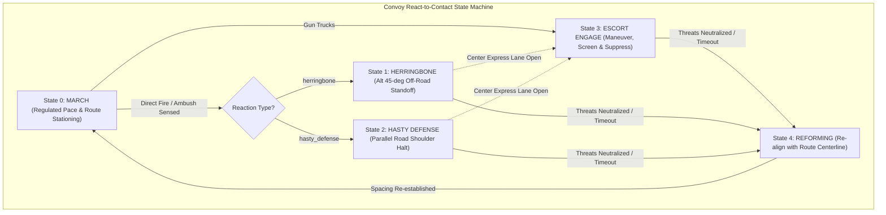

# Implementation Plan: Convoy Security Vehicles and Contact Reaction (Issue #12)

**Target Issue**: [#12: Convoy: security vehicles and a contact reaction](https://github.com/VadimSokolov/sandtable/issues/12)  
**Parent Roadmap**: Phase 4: Autonomy, C2 & Force Protection  
**Date**: October 2026 | **Status**: Proposed Plan  
**Target Branch**: `issue-12-convoy-security-contact-reaction` -> `convoy-dev`  
**Doctrinal References**:
- **ATP 4-11**: Army Motor Transport Operations (March 2026), Section 5-4 (Convoy Battle Drills) & Appendix G (Convoy Control).
- **ATP 4-01.45 / MCRP 3-40F.7 / NTTP 4-01.6 / AFTTP 3-2.58**: Multi-Service Tactics, Techniques, and Procedures for Tactical Convoy Operations, Chapter 4 (Battle Drills: React to Contact, Ambush, Defilade).
- **FM 4-0**: Sustainment Operations (March 2026), Chapter 1 (Contested Logistics & Survivability).
- **ATP 4-16**: Movement Control (April 2025), Appendix C (Column Movement & Pacing).

---

## 1. Executive Summary & Problem Statement

### The Problem in Current SandTable Simulation
In SandTable today, military convoys operate under strict peacetime movement rules:
1. **Passive "Sitting Ducks" Under Ambush**: When an enemy ambush team opens direct fire on a convoy, blue vehicles continue marching blindly along the route at regulated pace until killed. They neither pull off the roadway, nor seek deflection cover, nor adopt a defensive posture.
2. **Homogeneous Escort Capabilities**: While Issue #8 introduced `ROLE_SECURITY` and Issue #15 introduced `security_ratio`, security vehicles currently share the exact same movement logic, weapons, and passive behavior as unarmed 5-ton cargo trucks.
3. **Absence of Standard Doctrinal Battle Drills**: Army doctrine dictates immediate tactical reactions when taking contact. If the road is blocked or an ambush occurs in defilade, the column must either blow through the kill zone or immediately execute a **Herringbone Formation** (clearing the road at alternating 45-degree angles to direct armor and weapons outward while opening the center express lane) or a **Hasty Defense**. Dedicated armed gun trucks must aggressively maneuver, establish suppressive fire on ambushing positions, and screen the vulnerable cargo haulers.

### The Objective of Issue #12
Implement doctrinal security vehicle behaviors and automated react-to-contact battle drills:
- **Dedicated Armed Escorts (Lead / Trail / Mid)**: Explicit doctrinal placement of armed gun trucks at the lead (scout / route clearance), trail (rear security / wrecker overwatch), and interspersed along the column, with distinct weapon and sensor profiles.
- **Automated Contact Triggering & Net Broadcast**: Detect incoming direct fire or close-proximity ambushes and propagate a tactical contact alert across the march unit.
- **Doctrinal Herringbone Reaction Drill (ATP 4-11 § 5-4)**: Cargo vehicles clear the roadway, angling 45 degrees off-road in an alternating left/right herringbone posture, presenting oblique frontal armor and opening the roadway centerline.
- **Escort Suppressive Maneuver**: Security gun trucks pivot toward the threat, establish firing positions, lay down suppressive fire, and destroy ambushers.
- **Column Re-forming & Mission Resumption**: Once threats are neutralized, the convoy re-enters the road centerline, re-establishes regulated time-gap stationing, and completes the cargo delivery mission.
- **Strict Byte-Identity**: Reminiscent of all SandTable layers, when `contact_reaction` is unconfigured (`None` or `"none"`), simulation outcomes across all seeds remain 100% byte-identical.

---

## 2. Explicit Scope Boundaries

Following the SandTable Design Manifesto (`doc/contested_logistics_one_pager.md`):

- **In Scope**:
  - Discrete contact reaction states in the Blue behavior layer (`MARCH`, `HERRINGBONE`, `HASTY_DEFENSE`, `ESCORT_ENGAGE`, `REFORMING`).
  - Doctrinal escort placement schemes (`lead_trail`, `distributed`, `lead_only`, `trail_only`).
  - Escort platform differentiation: dedicated weapon range, lethality (`pk_base`), and suppression capabilities.
  - Geometric modeling of the 45-degree alternating Herringbone formation along 2D polyline routes and straight corridors.
  - Lateral shoulder displacement ($d_{\text{offset}}$) opening the centerline express lane.
  - Threat detection, contact alert broadcasting, and defensive engagement logic.
  - Column re-forming logic and resumption of arc-length stationing.
  - Quantitative contact KPIs (time-to-herringbone, contact duration, escort kill ratio, cargo saved).
  - Replay serialization and interactive visualization in `mission_viewer_v2.html`.
  - Full unit test acceptance suite.

- **Out of Scope**:
  - Dismounted infantry skirmishes or dismounted crew battle drills (UGVs and mounted crews only).
  - Indirect artillery call-for-fire missions or Close Air Support (CAS) 9-lines.
  - Complex dynamic obstacle construction (e.g., live vehicle wreckage burning or crater physics, addressed in upcoming Issue #14).
  - Radio electronic warfare jamming interactions with contact broadcast (addressed in upcoming Issue #17).

---

## 3. Doctrinal & Mathematical Foundations



### A. The 45-Degree Herringbone Geometry (ATP 4-11 & ATP 4-01.45)
During a convoy road halt under fire, vehicles pull to the road shoulders at an alternating 45-degree angle.

Let:
- $\mathbf{p}_i = (x_i, y_i)$ be the position of vehicle $i$.
- $s_i$ be vehicle $i$'s current arc-length coordinate along the route polyline.
- $\mathbf{t}(s_i) = (\cos \theta_i, \sin \theta_i)$ be the unit tangent vector of the road at station $s_i$.
- $\mathbf{n}(s_i) = (-\sin \theta_i, \cos \theta_i)$ be the unit normal vector (perpendicular to road, pointing left).

The assigned shoulder side $\sigma_i \in \{-1, +1\}$ alternates by column rank:
$$\sigma_i = \begin{cases} +1 & \text{if } i \pmod 2 = 1 \quad (\text{Right shoulder}) \\ -1 & \text{if } i \pmod 2 = 0 \quad (\text{Left shoulder}) \end{cases}$$

The commanded target posture $(\mathbf{p}_i^*, \theta_i^*)$ in Herringbone is:
$$\mathbf{p}_i^* = \mathbf{p}_{\text{center}}(s_i) - \sigma_i \cdot d_{\text{offset}} \cdot \mathbf{n}(s_i)$$
$$\theta_i^* = \theta_i + \sigma_i \cdot \theta_{\text{herringbone}}$$

Where:
- $d_{\text{offset}}$ is the lateral shoulder clearance distance (typically 8.0 to 14.0 m), clearing the road width $W_{\text{road}}$.
- $\theta_{\text{herringbone}} = \pi / 4 = 45.0^\circ$ (doctrinal herringbone angle).

#### Physical Advantages Captured in Model:
1. **Centerline Express Lane**:
   The distance between left and right vehicle centers across the roadway is:
   $$W_{\text{clear}} = 2 \cdot d_{\text{offset}} \approx 20.0 \text{ m} > W_{\text{veh}}$$
   This guarantees that the road centerline remains completely unobstructed for security escorts and recovery wreckers to maneuver.
2. **Deflection Cover Bonus**:
   Incoming direct fire striking at an oblique angle $\alpha \approx 45^\circ$ rather than broadside ($90^\circ$) encounters greater effective armor depth:
   $$T_{\text{eff}} = \frac{T_{\text{nominal}}}{\cos(\alpha)}$$
   In `engagement.py`, vehicles established in herringbone posture receive an effective cover/deflection factor $C_{\text{deflect}} = 0.25$, reducing incoming kill probability:
   $$P_{k, \text{herringbone}} = P_{k, \text{base}} \cdot (1 - C_{\text{cover}}) \cdot (1 - C_{\text{deflect}})$$

### B. Dedicated Armed Escort Placement (ATP 4-11 App. G)
A tactical convoy consists of march units with designated sections:
$$\text{March Unit} = [\text{HEAD}] + [\text{MAIN BODY}] + [\text{TRAIL}]$$

Under `escort_placement = "lead_trail"`:
- **Lead Escort** (Position $k = 1$): Placed directly behind the C2 Pacesetter ($k = 0$). Armed with high-rate direct-fire armament (`weapon_range = 800\text{ m}`, $P_k = 0.15$). Tasks: frontal security, immediate suppression of ambush points.
- **Trail Escort** (Position $k = N - 2$): Placed directly ahead of the Recovery Wrecker ($k = N - 1$). Tasks: rear guard, flank counter-attack.
- **Internal Escorts**: If $\text{security\_ratio} > 0.25$, intermediate gun trucks are interspersed at equal intervals along the main body.

---

## 4. System Architecture & Technical Design

```
+-------------------------------------------------------------------------------------------------+
|                                    Convoy Spec (convoy.py)                                     |
|                                                                                                 |
|  - contact_reaction: "herringbone" | "hasty_defense" | "none"                                   |
|  - escort_placement: "lead_trail" | "distributed" | "custom"                                    |
|  - herringbone_angle: 0.785 rad (45 deg)                                                        |
|  - herringbone_offset: 12.0 m                                                                   |
|  - contact_threat_range: 800.0 m                                                                |
|  - contact_clear_timeout: 15.0 s                                                                |
+-----------------------------------------------+-------------------------------------------------+
                                                |
                                                v
+-------------------------------------------------------------------------------------------------+
|                                 Entities SoA (entities.py)                                      |
|                                                                                                 |
|  - contact_state: np.ndarray (int8: MARCH=0, HERRINGBONE=1, HASTY_DEFENSE=2,                   |
|                                     ESCORT_ENGAGE=3, REFORMING=4)                               |
|  - herringbone_side: np.ndarray (int8: -1=LEFT, 0=NONE, +1=RIGHT)                               |
|  - under_fire_timer: np.ndarray (int32: steps since last contact)                               |
+-----------------------------------------------+-------------------------------------------------+
                                                |
                        +-----------------------+-----------------------+
                        |                                               |
                        v                                               v
+-----------------------------------------------+   +---------------------------------------------+
|          Behavior Layer (behavior.py)         |   |         Planning & Motion Engine            |
|                                               |   |                                             |
| - Contact Triggering: incoming fire or sensed |   | - Herringbone target generation:            |
|   threats within contact_threat_range         |   |   p* = p_center(s) - side * d_offset * n(s) |
| - State Transitions:                          |   | - 45-degree heading orientation             |
|   MARCH -> HERRINGBONE / ESCORT_ENGAGE        |   | - Escort threat pursuit and screening       |
|   Neutralization -> REFORMING -> MARCH        |   | - Centerline re-entry on REFORMING          |
+-----------------------------------------------+   +---------------------------------------------+
                        |                                               |
                        +-----------------------+-----------------------+
                                                |
                                                v
+-------------------------------------------------------------------------------------------------+
|                                 Engagement & Combat (engagement.py)                             |
|                                                                                                 |
| - Escort target prioritization: Gun trucks engage threats targeting cargo haulers               |
| - Deflection cover bonus for vehicles established in 45-deg Herringbone posture                 |
+-----------------------------------------------+-------------------------------------------------+
                                                |
                                                v
+-------------------------------------------------------------------------------------------------+
|                                 Scoring & Replay Integration                                    |
|                                                                                                 |
| - convoy_metrics.py: time_to_herringbone, contact_duration, escort_kills                        |
| - replay.py: record contact_state, herringbone_side, and engagement lines                       |
| - mission_viewer_v2.html: render live contact banners, herringbone postures, escort arcs        |
+-----------------------------------------------+-------------------------------------------------+
```

---

## 5. Detailed Step-by-Step Implementation Phases

### Phase 1: Data Model & Convoy Specification (`convoy.py`, `entities.py`, `scenario.py`)

#### 1.1 State Constants & Doctrinal Boundaries (`src/sandtable/convoy.py`)
Add contact reaction states and configuration parameters:
```python
CONTACT_STATE_MARCH = 0
CONTACT_STATE_HERRINGBONE = 1
CONTACT_STATE_HASTY_DEFENSE = 2
CONTACT_STATE_ESCORT_ENGAGE = 3
CONTACT_STATE_REFORMING = 4

ESCORT_LEAD_TRAIL = "lead_trail"
ESCORT_DISTRIBUTED = "distributed"
ESCORT_CUSTOM = "custom"
```

Add new keys to `CONVOY_KEYS`:
- `contact_reaction`: `"herringbone" | "hasty_defense" | "none"` (default `"none"`).
- `escort_placement`: `"lead_trail" | "distributed" | "custom"` (default `"lead_trail"`).
- `herringbone_angle`: float, range $(0.0, \pi/2]$ (default $\pi/4 = 0.7854$ rad).
- `herringbone_offset`: float, range $[2.0, 50.0]$ m (default $12.0$ m).
- `contact_threat_range`: float, range $[100.0, 2500.0]$ m (default $800.0$ m).
- `contact_clear_timeout`: float, range $[1.0, 300.0]$ s (default $15.0$ s).
- `escort_ptype`: optional string key in `platform_types` for dedicated security platforms.

#### 1.2 Layout Engine Enhancements (`build_convoy_layout` in `src/sandtable/convoy.py`)
Enhance role allocation when `escort_placement == "lead_trail"`:
- Head ($k = 0$): `ROLE_CONTROL` (Commander / Pacesetter).
- Immediate Follower ($k = 1$): `ROLE_SECURITY` (Lead Gun Truck Escort).
- Trail Element ($k = N - 1$): `ROLE_RECOVERY` (Wrecker).
- Penultimate Element ($k = N - 2$): `ROLE_SECURITY` (Trail Gun Truck Escort).
- Main Body ($2 \le k \le N - 3$): Allocated to `ROLE_CARGO` and intermediate `ROLE_SECURITY` based on `security_ratio`.

#### 1.3 Entities SoA Updates (`src/sandtable/entities.py`)
Add fields to `Entities` dataclass:
```python
contact_state: np.ndarray = None       # int8: CONTACT_STATE_*
herringbone_side: np.ndarray = None    # int8: -1 (left), 0 (center), +1 (right)
under_fire_timer: np.ndarray = None    # int32: ticks since last contact detected
```
In `__post_init__`, initialize to neutral defaults:
- `contact_state = np.zeros(self.n, dtype=np.int8)`
- `herringbone_side = np.zeros(self.n, dtype=np.int8)`
- `under_fire_timer = np.full(self.n, -1, dtype=np.int32)`

#### 1.4 Scenario Construction (`src/sandtable/scenario.py`)
In `build_entities`:
- When `escort_ptype` is specified in scenario params/convoy spec, platforms with `convoy_role == ROLE_SECURITY` inherit combat capabilities (`weapon_range`, `pk_base`, `turn_rate`, `hp`) from `escort_ptype`.

---

### Phase 2: Contact Detection & Behavior State Machine (`behavior.py`)

#### 2.1 Contact Triggering Logic (`_check_convoy_contact`)
In `src/sandtable/behavior.py`:
A convoy enters contact if:
1. Direct fire damage or incoming fire was recorded against any Blue convoy vehicle in the previous step (`ent.hp < prev_hp` or engagement events).
2. Or a living Red ground entity is detected (`ent.seen == True`) within `contact_threat_range` of any living Blue convoy vehicle and line-of-sight is clear.

#### 2.2 Tactical Reaction Drill Execution
When contact is confirmed:
1. **Security Vehicles (`ROLE_SECURITY`)**:
   - Transition to `CONTACT_STATE_ESCORT_ENGAGE`.
   - Acquire the closest detected enemy threat.
   - Maneuver off the centerline or pivot to face the threat directly, establishing maximum rate of fire.
2. **Cargo and Support Elements (`ROLE_CARGO`, `ROLE_CONTROL`, `ROLE_RECOVERY`)**:
   - If `contact_reaction == "herringbone"`:
     - Transition to `CONTACT_STATE_HERRINGBONE`.
     - Assign alternating shoulder sides:
       - Odd rank vehicles: `herringbone_side = +1` (Right).
       - Even rank vehicles: `herringbone_side = -1` (Left).
     - Decelerate speed to zero upon reaching shoulder offset.
     - Pivot vehicle heading to $\theta_{\text{target}} = \theta_{\text{road}} + \sigma_i \cdot \theta_{\text{herringbone}}$.
   - If `contact_reaction == "hasty_defense"`:
     - Transition to `CONTACT_STATE_HASTY_DEFENSE`.
     - Halt in place along road edge, maintaining in-line dispersion.

#### 2.3 Contact Clearing & Re-forming Drill
1. If no living Red threats remain within `contact_threat_range` for $T_{\text{clear}} = \text{contact\_clear\_timeout}$:
   - All surviving vehicles transition to `CONTACT_STATE_REFORMING`.
   - Shoulder offsets and herringbone angles ramp smoothly back to route centerline ($\sigma_i \to 0, \theta \to \theta_{\text{road}}$).
   - Once vehicles re-enter the road lane, state returns to `CONTACT_STATE_MARCH`.
   - Regulated pacing and arc-length follower tracking resume automatically.

---

### Phase 3: Kinematics & Target Generation (`planning.py`, `motion.py`)

#### 3.1 Planning Integration for Herringbone Targets
In `src/sandtable/planning.py`:
When an entity $i$ is in `CONTACT_STATE_HERRINGBONE`:
1. Retrieve vehicle's road progress station $s_i$.
2. Compute route center point $\mathbf{p}_{\text{center}} = \text{point\_at}(s_i)$ and tangent $\theta_i$.
3. Compute normal vector $\mathbf{n}_i = (-\sin \theta_i, \cos \theta_i)$.
4. Commanded waypoint:
   $$\mathbf{p}_{\text{tgt}, i} = \mathbf{p}_{\text{center}} - \sigma_i \cdot d_{\text{offset}} \cdot \mathbf{n}_i$$
5. Commanded heading:
   $$\theta_{\text{tgt}, i} = \theta_i + \sigma_i \cdot \theta_{\text{herringbone}}$$
6. Velocity command:
   $$\text{dist\_to\_shoulder} = \|\mathbf{p}_i - \mathbf{p}_{\text{tgt}, i}\|$$
   $$v_{\text{cmd}, i} = \min(v_{\text{max}}, \text{dist\_to\_shoulder} / \Delta t)$$

#### 3.2 Escort Maneuver Targeting
When an entity $j$ is in `CONTACT_STATE_ESCORT_ENGAGE`:
1. Target the position of the nearest detected Red ground vehicle.
2. If distance $> R_{\text{weapon}} \cdot 0.75$, advance toward firing standoff.
3. If distance $\le R_{\text{weapon}} \cdot 0.75$, halt and maintain heading aligned with the threat.

---

### Phase 4: Combat & Engagement Modulation (`engagement.py`)

In `src/sandtable/engagement.py`:
1. **Deflection Cover**:
   - Entities in `CONTACT_STATE_HERRINGBONE` established within $5^\circ$ of their commanded herringbone angle receive an armor deflection bonus:
     $$P_k = P_k \cdot (1.0 - C_{\text{deflect}}), \quad C_{\text{deflect}} = 0.25$$
2. **Escort Suppressive Priority**:
   - Security gun trucks (`ROLE_SECURITY`) prioritize Red shooters that have engaged Blue cargo vehicles within the last 5 timesteps.

---

### Phase 5: Metrics, Verification & Scoring (`convoy_metrics.py`, `metrics.py`)

#### 5.1 Tactical Force Protection Metrics
Extend `src/sandtable/convoy_metrics.py` and `metrics.py` to record:
- `convoy_contact_count`: Total number of contact engagements triggered.
- `convoy_contact_duration`: Total seconds spent in defensive contact posture.
- `convoy_herringbone_formation_time`: Time in seconds from first shot to full herringbone alignment.
- `convoy_escort_kills`: Number of Red entities destroyed by `ROLE_SECURITY` escorts.
- `convoy_cargo_saved`: Additional cargo delivered compared to passive march baseline.

---

### Phase 6: Interactive Mission Viewer v2 Integration (`make_mission_viewer_v2.py`)

1. Update `tools/make_mission_viewer_v2.py`:
   - Replace synthetic timeline mock in `_generate_upcoming_herringbone_trace()` with true simulated trace executing the real `run_mission` with `contact_reaction="herringbone"`.
2. Telemetry Rail Display:
   - Display dynamic contact alert badge: `CONTACT! DIRECT FIRE (HERRINGBONE DEFENSE)`.
   - Show vehicle status pills: `HERRINGBONE (R)`, `HERRINGBONE (L)`, `ESCORT ENGAGING`, `RE-FORMING`.
   - Render gun truck weapon fire vectors directed at ambushers.

---

## 6. File Modification Manifest

| File | Action | Purpose |
|------|--------|---------|
| `src/sandtable/convoy.py` | Modify | Add contact state constants, config validation, and lead/trail escort layout assignment. |
| `src/sandtable/entities.py` | Modify | Add `contact_state`, `herringbone_side`, `under_fire_timer` arrays to `Entities`. |
| `src/sandtable/scenario.py` | Modify | Support `escort_ptype` platform inheritance and contact reaction parameters. |
| `src/sandtable/behavior.py` | Modify | Implement contact detection, contact net broadcast, and drill state transitions. |
| `src/sandtable/planning.py` | Modify | Generate herringbone shoulder waypoints, 45-deg headings, and escort intercept targets. |
| `src/sandtable/engagement.py` | Modify | Apply deflection cover bonus in herringbone posture and escort target prioritization. |
| `src/sandtable/convoy_metrics.py` | Modify | Add tactical force protection KPIs and reaction timing metrics. |
| `src/sandtable/metrics.py` | Modify | Expose convoy contact metrics in `sim.run_mission` output dictionary. |
| `src/sandtable/replay.py` | Modify | Record `contact_state` and `herringbone_side` into frame snapshots. |
| `tools/make_mission_viewer_v2.py` | Modify | Generate live simulated trace for Issue #12 in `mission_viewer_v2.html`. |
| `tests/test_convoy_contact_reaction.py` | Create | Dedicated unit test suite with 10+ acceptance tests. |

---

## 7. Verification & Acceptance Criteria

A dedicated test suite `tests/test_convoy_contact_reaction.py` will validate:

1. **Test 1: Byte-Identity When Off**:
   - `test_contact_reaction_off_is_byte_identical`: When `contact_reaction` is `None` or `"none"`, simulation metrics across multiple seeds match bit-for-bit with the pre-existing codebase.
2. **Test 2: Doctrinal Bounds & Specification Validation**:
   - `test_convoy_contact_spec_validation`: Invalid angles ($> 90^\circ$ or $\le 0^\circ$), invalid offsets, or unknown reaction types raise descriptive `ValueError` exceptions.
3. **Test 3: Escort Placement Architecture**:
   - `test_lead_trail_escort_layout`: Verifies that `escort_placement="lead_trail"` correctly places gun trucks at position 1 (head escort) and $N-2$ (trail escort).
4. **Test 4: Contact Alert Triggering**:
   - `test_contact_trigger_on_incoming_fire`: Taking incoming fire immediately transitions convoy from `MARCH` to `HERRINGBONE` and `ESCORT_ENGAGE`.
5. **Test 5: 45-Degree Herringbone Geometry**:
   - `test_herringbone_posture_angles_and_offsets`: Asserts that odd vehicles angle $+45^\circ \pm 2^\circ$ right of road and evens $-45^\circ \pm 2^\circ$ left of road, with lateral offset $d_{\text{offset}} \pm 1.0$ m.
6. **Test 6: Centerline Express Lane Preservation**:
   - `test_centerline_express_lane_unobstructed`: Asserts that no cargo vehicle occupies the road corridor $|d_\perp| < 3.0$ m while in herringbone posture.
7. **Test 7: Escort Suppressive Engagement**:
   - `test_escorts_neutralize_ambush`: Verifies that armed gun trucks maneuver, engage, and destroy ambushing red platforms.
8. **Test 8: Column Re-forming on Threat Clearance**:
   - `test_column_reforming_after_neutralization`: Asserts that once threats are destroyed, vehicles transition to `REFORMING`, return to road centerline, and resume march.
9. **Test 9: Cargo Delivery Completion**:
   - `test_cargo_delivered_post_contact`: Asserts that cargo delivery fraction reaches 100% after contact is successfully cleared.
10. **Test 10: Hasty Defense Alternative Posture**:
    - `test_hasty_defense_reaction`: Verifies parallel shoulder halt when `contact_reaction="hasty_defense"`.

---

## 8. Risk Analysis & Mitigation Strategies

1. **Risk: String Instability During Re-forming**:
   - *Problem*: When 15 vehicles re-enter the road simultaneously, follower vehicles may collide or bunch up.
   - *Mitigation*: Succession and re-forming are executed in echelon from Head to Trail; followers do not advance until their immediate predecessor has achieved road tangent heading and headway clearance.
2. **Risk: Off-Road Terrain Collisions During Herringbone**:
   - *Problem*: Angling 45 degrees off-road in narrow urban streets could clip building boxes.
   - *Mitigation*: Lateral offset $d_{\text{offset}}$ is clamped by available road width or building setback from `world.building_boxes` or street graph `width`. If width is constrained, vehicles automatically fall back to `HASTY_DEFENSE`.
3. **Risk: Floating Point Heading Ambiguities Around $\pm \pi$**:
   - *Problem*: Road tangents crossing the $-\pi / +\pi$ branch cut could cause vehicles to turn $315^\circ$ the wrong way.
   - *Mitigation*: Heading interpolation uses standard angular difference wrapping $\Delta \theta = \text{atan2}(\sin(\theta_2 - \theta_1), \cos(\theta_2 - \theta_1))$.

---

## 9. Conclusion & Next Steps

This plan establishes the complete mathematical, doctrinal, and software foundation for **Phase 4: Issue #12 (Security Vehicles & Contact Reaction)**. Once approved:
1. Create Git branch `issue-12-convoy-security-contact-reaction`.
2. Implement Phases 1 through 6 incrementally.
3. Validate with `pytest tests/test_convoy_contact_reaction.py`.
4. Update `mission_viewer_v2.html` with real simulated traces.
5. Merge into `convoy-dev`.

