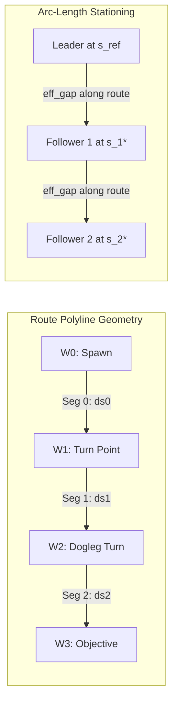
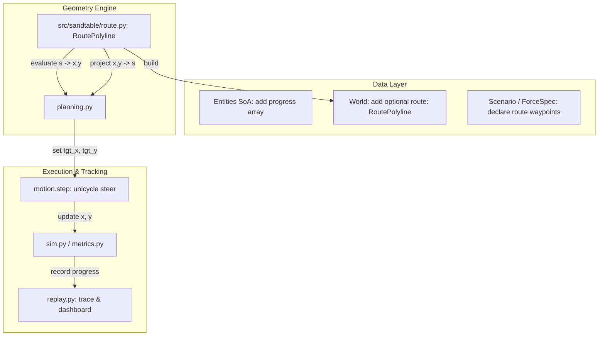
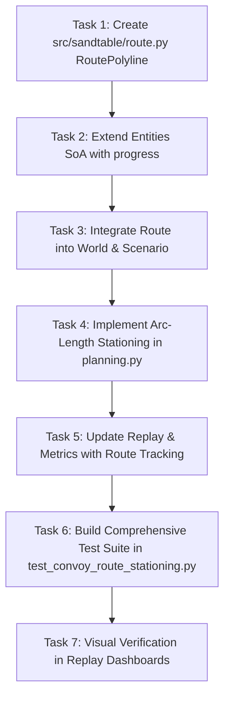

# Implementation Plan: Convoy Stationing by Arc Length Along a Route (Issue #13)

**Parent Roadmap**: Phase 3: Route Stationing & Urban Street Graphs  
**Target Issue**: [#13: Convoy: stationing by arc length along a route](https://github.com/VadimSokolov/sandtable/issues/13)  
**Branch**: `issue-13-convoy-route-stationing` -> `convoy-dev`  
**Doctrinal References**: ATP 4-16 (Movement Control, App. C), ATP 4-11 (Convoy Operations, App. G & M), FM 4-0 (Sustainment Operations)  

---

## 1. Executive Summary and Problem Statement

### The Core Failure of Euclidean Heading-Offset Stationing
In military convoy operations on real roads, streets, and terrain, columns navigate through turns, bends, intersections, and doglegs.

Currently in SandTable (`src/sandtable/planning.py`, lines 163-166):
Follower vehicle target positions are computed as a straight-line Euclidean vector backwards along the reference vehicle's instantaneous heading:
$$\mathbf{p}_{\text{tgt}} = \mathbf{p}_{\text{leader}} - \text{rank} \cdot \text{eff\_gap} \cdot \mathbf{u}_{\text{heading}}$$

This formulation works **only** on a perfectly straight line. The moment a column encounters a curve, 90-degree turn, or dogleg:
1. **Corner-Cutting**: When the lead vehicle executes a turn (e.g., turning from East to North), its instantaneous heading changes to North. Its follower (e.g., 50 meters behind) is immediately commanded to a point 50 meters South of the leader. This target sits completely off-road in open terrain, causing the follower to cut across fields, hit obstacles, or leave cover.
2. **Artificial Gap Compression**: Straight Euclidean distance measures the "chord" between two vehicles across open terrain. Around a curve, the Euclidean distance is strictly less than the actual roadway distance:
   $$d_{\text{chord}} < \Delta s_{\text{road}}$$
   This gives a false impression of inter-vehicle crowding and miscalculates road clearance and safety buffers.
3. **ATP 4-16 Doctrinal Invalidation**: Army Movement Control doctrine (ATP 4-16, para C-4) defines column length, road space, and passage time along the **road centerline** (arc-length stationing coordinate $s$), not Euclidean chords across terrain.

### Objective of Issue #13
Introduce a 1-dimensional arc-length coordinate system ($s \in [0, L_{\text{route}}]$) parameterized along arbitrary 2D polyline routes, so that:
- Vehicle positions, follower stations, and column gaps are measured along the roadway surface.
- Vehicles negotiate corners and doglegs sequentially without cutting corners.
- Non-route scenarios remain 100% byte-identical.
- On a straight route, arc-length stationing produces results that match Euclidean stationing within numerical floating-point precision.

---

## 2. Mathematical Formulation



### A. RoutePolyline Parameterization
A route is defined by $K$ ordered 2D vertices (waypoints):
$$\mathcal{W} = \left[ \mathbf{w}_0, \mathbf{w}_1, \dots, \mathbf{w}_{K-1} \right], \quad \mathbf{w}_k = (x_k, y_k) \in \mathbb{R}^2$$

- **Segment Vectors**: $\Delta \mathbf{w}_k = \mathbf{w}_{k+1} - \mathbf{w}_k$ for $k \in \{0, \dots, K-2\}$.
- **Segment Lengths**: $\Delta s_k = \|\Delta \mathbf{w}_k\|_2$.
- **Cumulative Arc Lengths**:
  $$s_0 = 0, \quad s_{k+1} = s_k + \Delta s_k, \quad L_{\text{route}} = s_{K-1}$$

### B. Forward Mapping: $\text{point\_at}(s) \to (x, y, \theta)$
Given an arc-length station coordinate $s \in [0, L_{\text{route}}]$:
1. Locate segment index $k$ such that $s_k \le s \le s_{k+1}$ (with endpoint clamping).
2. Compute normalized segment fraction:
   $$\tau = \frac{s - s_k}{\Delta s_k} \in [0, 1]$$
3. Interpolate 2D position and tangent heading:
   $$\mathbf{p}(s) = \mathbf{w}_k + \tau \Delta \mathbf{w}_k$$
   $$\theta(s) = \text{atan2}(\Delta y_k, \Delta x_k)$$

### C. Backward Mapping: $\text{project}(\mathbf{p}) \to (s, d_{\perp})$
Given any vehicle position $\mathbf{p} = (x, y)$:
1. For each segment $k$, project $\mathbf{p}$ onto line segment $\overline{\mathbf{w}_k \mathbf{w}_{k+1}}$:
   $$\tau_k = \text{clip}\left( \frac{(\mathbf{p} - \mathbf{w}_k) \cdot \Delta \mathbf{w}_k}{\|\Delta \mathbf{w}_k\|^2}, 0.0, 1.0 \right)$$
   $$\mathbf{p}_{\text{proj}, k} = \mathbf{w}_k + \tau_k \Delta \mathbf{w}_k$$
   $$d_k = \|\mathbf{p} - \mathbf{p}_{\text{proj}, k}\|_2$$
2. The global projection is the segment $k^*$ minimizing orthogonal distance $d_k$:
   $$s^*(\mathbf{p}) = s_{k^*} + \tau_{k^*} \Delta s_{k^*}$$
   $$d_{\perp}(\mathbf{p}) = d_{k^*}$$

### D. Doctrinal Arc-Length Follower Stationing
For vehicle $i$ tracking reference vehicle $\text{ref} = \text{predecessor}(i)$:
1. Project reference vehicle onto route:
   $$s_{\text{ref}} = s^*(\mathbf{p}_{\text{ref}})$$
2. Compute commanded station coordinate along route:
   $$s_i^* = \max\left(0.0, s_{\text{ref}} - \text{rank}_i \cdot \text{eff\_gap}(v_{\text{ref}})\right)$$
   where $\text{eff\_gap}(v) = \max(\text{gap}_{\text{min}}, v \cdot t_{\text{gap}})$.
3. Evaluate 2D target waypoint from route:
   $$\mathbf{p}_{\text{tgt}, i} = \text{point\_at}(s_i^*)$$
4. Compute true along-track and cross-track station errors:
   $$e_{\text{along}, i} = s^*(\mathbf{p}_i) - s_i^* \quad (\text{longitudinal pacing error})$$
   $$e_{\text{cross}, i} = d_{\perp}(\mathbf{p}_i) \quad (\text{lateral off-road deviation})$$

---

## 3. Architecture and System Design



### A. New Module: `src/sandtable/route.py`
A dedicated, lightweight, zero-dependency geometry module:
- Class `RoutePolyline`:
  - `waypoints: np.ndarray` of shape $(K, 2)$.
  - `cum_dist: np.ndarray` of shape $(K,)$ storing cumulative arc lengths $s_0, \dots, s_{K-1}$.
  - `total_length: float`.
  - Methods:
    - `point_at(s: float | np.ndarray) -> tuple[np.ndarray, np.ndarray, np.ndarray]`: Returns $(x, y, \theta)$.
    - `project(x: float | np.ndarray, y: float | np.ndarray) -> tuple[np.ndarray, np.ndarray]`: Returns $(s, d_{\perp})$.
    - `sample_path(step: float = 10.0) -> np.ndarray`: Returns discretized points for visual rendering.
    - `from_waypoints(pts: list[tuple[float, float]] | np.ndarray) -> RoutePolyline`.

### B. State Extensions (`src/sandtable/entities.py`)
Add `progress` coordinate to `Entities` SoA:
```python
# Convoy route stationing (Phase 3, Issue #13)
progress: np.ndarray = None  # float: arc-length coordinate along the route (m), or NaN if unrouted
```
- In `__post_init__`, default `progress` to `np.full(n, np.nan, dtype=np.float64)`.
- When no route is configured, `progress` is unused, ensuring 100% byte-identity.

### C. World and Scenario Integration (`src/sandtable/world.py` & `src/sandtable/scenario.py`)
- In `Scenario` / `ForceSpec`:
  - `ForceSpec.route` already exists (`list | None = None`).
  - Allow route definition either via `f.route`, `scn.params["route"]`, or `scn.terrain["route"]`.
- In `build_world`:
  - If a route is specified, build and store `world.route = RoutePolyline.from_waypoints(route_data)`.
  - If no route is specified, `world.route = None`.
- In `build_entities`:
  - When a route is present, vehicles spawn stationed along the route polyline at arc-length intervals:
    $$s_k = s_{\text{spawn}} - k \cdot \text{gap}$$
    $$(x_k, y_k, \theta_k) = \text{world.route.point\_at}(s_k)$$

### D. Planning Updates (`src/sandtable/planning.py`)
- In `_behavior_targets`:
  - Check `if getattr(world, "route", None) is not None:`.
  - **Route Active**:
    - Project tracked leader: $s_{\text{ref}} = \text{route.project}(\text{trk\_x}[i], \text{trk\_y}[i])[0]$.
    - Station coordinate: $s_i^* = \max(0.0, s_{\text{ref}} - \text{rank} \cdot \text{eff\_gap})$.
    - Commanded target: $(tx_{\text{new}}[i], ty_{\text{new}}[i], \_) = \text{route.point\_at}(s_i^*)$.
    - Along-track and cross-track errors:
      $$s_i, d_{\perp, i} = \text{route.project}(\text{ent.x}[i], \text{ent.y}[i])$$
      $$\text{bhv.st\_along\_sum}[i] += |s_i - s_i^*|$$
      $$\text{bhv.st\_cross\_sum}[i] += d_{\perp, i}$$
      $$\text{ent.progress}[i] = s_i$$
  - **Route Inactive (`world.route is None`)**:
    - Keep the existing Euclidean heading offset code completely untouched. Byte-identity guaranteed!
- For Lead Vehicle (`role == 0` / Pacesetter):
  - When route is active, advance carrot along route:
    $$s_{\text{lead}} = \text{route.project}(\text{ent.x}[i], \text{ent.y}[i])[0]$$
    $$s_{\text{carrot}} = \min(s_{\text{lead}} + \text{lookahead}, L_{\text{route}})$$
    $$(tx_{\text{new}}[i], ty_{\text{new}}[i], \_) = \text{route.point\_at}(s_{\text{carrot}})$$

### E. Simulation & Replay (`src/sandtable/sim.py` & `src/sandtable/replay.py`)
- In `sim.step`: update `ent.progress` using `world.route.project(ent.x, ent.y)` if route is active.
- In `replay.record_trace`:
  - Include `"route": world.route.waypoints.tolist()` in replay metadata if present.
  - Include `"progress": [round(float(s), 1) for s in ent.progress]` in per-frame vehicle state.

---

## 4. Step-by-Step Implementation Tasks



### Task 1: Create `src/sandtable/route.py`
Implement `RoutePolyline`:
- Full vectorized geometric methods for cumulative distance, segment indexing, interpolation, and orthogonal point projection.
- Edge cases: $s \le 0$, $s \ge L$, zero-length segments, collinear points.

### Task 2: Extend `Entities` SoA in `src/sandtable/entities.py`
- Add `progress: np.ndarray = None`.
- Default to `np.full(n, np.nan)` in `__post_init__` and `Entities.allocate`.

### Task 3: Integrate Route into `World` and `Scenario`
- Add `route: RoutePolyline | None = None` to `World`.
- Update `build_world` to construct `world.route` from `scn.params["route"]`, `scn.forces[0].route`, or `scn.terrain["route"]`.
- Update `build_entities` to position convoy vehicles along the route at spawn when a route is present.

### Task 4: Implement Arc-Length Stationing in `src/sandtable/planning.py`
- Update `step` and `_behavior_targets` to use `world.route`:
  - Pacesetter / Lead vehicle advances along the route polyline.
  - Follower vehicles station at $s_i^* = s_{\text{ref}} - \text{rank} \cdot \text{eff\_gap}$.
  - Compute true $e_{\text{along}}$ and $e_{\text{cross}}$ from route projection.

### Task 5: Update Replay and Metrics
- Pass route polyline into replay metadata for canvas rendering.
- Record `progress` in frame dumps.

### Task 6: Acceptance Test Suite (`tests/test_convoy_route_stationing.py`)
1. **Byte-Identity when Route is Off**:
   - `test_route_off_is_byte_identical`: Verifies existing scenarios produce identical bit-for-bit results.
2. **Straight Route Equivalence**:
   - `test_straight_route_matches_euclidean_stationing`: On an East-West straight line, arc-length stationing produces positions matching the unrouted baseline within $10^{-6}$ m.
3. **Dogleg 90-Degree Turn Test**:
   - `test_dogleg_holds_gap_and_prevents_corner_cutting`:
     - Convoy navigates an L-shaped corridor (East 1000m, then North 1000m).
     - Verifies follower does NOT cut corner across open terrain ($d_{\perp} < 5.0$m at all times).
     - Verifies inter-vehicle gap measured along the road holds at $s_{\text{leader}} - s_{\text{follower}} \approx \text{eff\_gap}$.
4. **Projection / Point-At Invariant**:
   - `test_route_projection_invertibility`: $\text{project}(\text{point\_at}(s))[0] \equiv s$ for all $s \in [0, L]$.
5. **Along-Track vs Cross-Track Error Separation**:
   - `test_stationing_error_decomposition`: Inducing a slowdown increases along-track error without changing cross-track error; lateral nudges increase cross-track error.
6. **Chain vs Star Succession on Curved Route**:
   - `test_convoy_succession_on_curved_route`: Removing the lead vehicle smoothly promotes follower 1 without breaking route tracking.

### Task 7: Visual Verification
- Add a dogleg route scenario in `report/viz/` and verify in the visualizer.

---

## 5. Verification Checklist

- [ ] All 32 existing convoy tests pass without modification.
- [ ] Non-convoy baseline scenarios remain 100% byte-identical.
- [ ] Route polyline supports arbitrary 2D paths (L-turns, S-curves, doglegs).
- [ ] Followers do not cut corners around turns.
- [ ] Inter-vehicle gap holds along the road arc length $\Delta s$.
- [ ] No em dashes in code, comments, docstrings, or artifacts.
