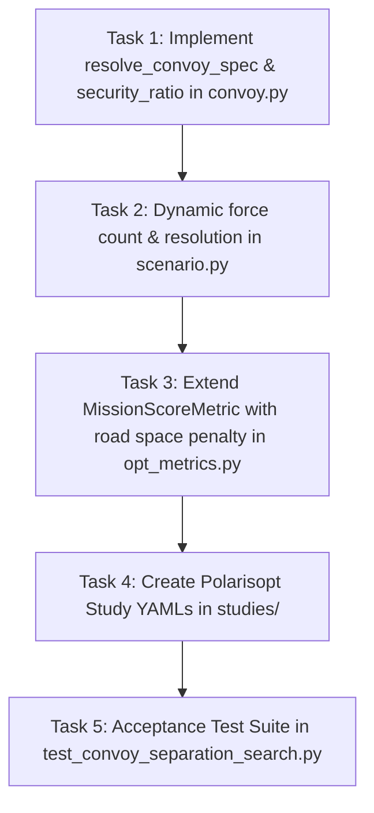

# Implementation Plan - Issue #15: Convoy Separation Parameters as Search Dimensions

**Parent Roadmap**: Phase 1: Straight Road Movement & Doctrine Arithmetic  
**Target Issue**: [Issue #15: Convoy: separation parameters as search dimensions](https://github.com/VadimSokolov/sandtable/issues/15)  
**Branch**: `issue-15-convoy-separation-search` -> `convoy-dev`  
**Doctrinal References**: ATP 4-11 (Army Motor Transport Operations, App. G & M), ATP 4-16 (Movement Control, App. C), FM 4-0 (Sustainment Operations, para 1-46)  

---

## 1. Doctrinal Motivation and Problem Statement

### The G-9 Tradeoff: Separation vs. Road Space
Army Doctrine **ATP 4-11 (para G-9)** explicitly defines the fundamental dilemma of convoy movement control:
> *"Keep march units large because the gaps between small ones consume road space, and split into serials when security warrants more separation."*

Furthermore, **FM 4-0 (para 1-46)** states that distributed sustainment operations improve survivability under enemy observation and drone strikes, but at the cost of transportation efficiency.

In SandTable, this dilemma forms an Pareto frontier:
- **Concentrated Formations (Large march units, small time gaps)**:
  - Pros: Minimal Column Length ($CL$), low Road Space ($RS$), fast Pass Time ($PT$), high route throughput.
  - Cons: High vulnerability to mass-casualty attacks and aerial drone strikes (dense target clustering).
- **Dispersed Formations (Small march units, multiple serials, wide time gaps)**:
  - Pros: Lower vulnerability, reduced target density, resilience to ambushes.
  - Cons: Enormous Column Length, inflated Road Space, prolonged Road Clearance Time ($RCT$).

### The Simulator Gap
Currently:
- Convoy parameters are defined inside a static nested dictionary (`scn.params["convoy"]`).
- Optimization frameworks like **polarisopt** (and Latin Hypercube sweeps / Bayesian Optimization) operate over **flat design parameter dictionaries** (`params: {"pace": ..., "time_gap": ...}`).
- Design dimensions such as `march_unit_size`, `pace`, `time_gap`, `element_time_gap`, and `security_ratio` cannot be searched directly without manual script intervention.
- The Blue force count is rigidly bound to `ForceSpec.count`, preventing sweeps over march unit sizes ($K$) and serial counts ($S$).

Issue #15 exposes these convoy parameters as first-class search dimensions for DOE sweeps and Bayesian Optimization via `polarisopt`, while ensuring that registered baseline parameters reproduce baseline metrics with 100% precision.

---

## 2. Mathematical Specification of Search Dimensions

| Parameter | Type | Doctrinal Range | Default Baseline | Description |
|---|---|---|---|---|
| `pace` | Float | $[5.0, 20.0]$ m/s | $10.0$ m/s | Regulated column speed set by pacesetter vehicle |
| `time_gap` | Float | $[2.0, 15.0]$ s | $4.0$ s | Intra-element time gap between vehicles in a march unit |
| `element_time_gap` | Float | $[10.0, 60.0]$ s | $20.0$ s | Inter-element time gap between successive march units |
| `serial_time_gap` | Float | $[20.0, 180.0]$ s | $30.0$ s | Inter-serial time gap between successive serials |
| `march_unit_size` ($K$) | Integer | $[3, 10]$ | $5$ | Number of vehicles per march unit |
| `march_units_per_serial` ($M$) | Integer | $[2, 5]$ | $3$ | Number of march units per serial |
| `serials_per_column` ($S$) | Integer | $[1, 4]$ | $1$ | Number of serials per column |
| `security_ratio` | Float | $[0.0, 0.6]$ | $0.2$ | Fraction of cargo slots assigned to armed escort (gun trucks) |
| `safety_factor` | Float | $[0.0, 0.3]$ | $0.0$ | Operational buffer added to road space ($RS = CL \times (1 + s_f)$) |

---

### A. Dynamic Security Allocation (`security_ratio`)
In a march unit of size $K$:
- Slot 0 is reserved for Command & Control / Pacesetter (`ROLE_CONTROL`).
- Slot $K - 1$ (if $K > 1$) is reserved for Recovery / Maintenance (`ROLE_RECOVERY`).
- The remaining $K - 2$ slots are flexible payload slots.
- The number of security gun trucks allocated is:
  $$N_{\text{sec}} = \min(K - 2, \max(0, \text{round}((K - 2) \times \text{security\_ratio})))$$
- The first $N_{\text{sec}}$ flexible slots receive `ROLE_SECURITY`, and the remainder receive `ROLE_CARGO`.

---

### B. Multi-Objective Cost Function for Bayesian Optimization
In `src/sandtable/opt_metrics.py`, we extend `MissionScoreMetric` with an optional convoy road-space penalty:
$$J = w_{\text{fail}} (1 - \text{success}) + w_{\text{time}} \frac{\text{time\_to\_obj}}{\text{time\_scale}} + w_{\text{loss}} \text{blue\_loss\_frac} + w_{\text{road}} \frac{\text{convoy\_road\_space}}{\text{road\_scale}}$$
Where:
- $w_{\text{road}} \ge 0.0$ (default $0.0$ for backward compatibility).
- $\text{road\_scale}$ is the reference route or road space normalizer (e.g. $2000.0$ m).

This prices the exact G-9 tradeoff: the optimizer must find the sweet spot where the convoy is dispersed enough to survive red fires, but compact enough not to blow out road space and transit time.

---

## 3. Architecture & Parameter Resolution

```mermaid
graph TD
    subgraph Polarisopt / User Inputs
        P_FLAT[Flat params: pace, time_gap, march_unit_size, security_ratio]
        STUDY[polarisopt Study YAML: uc3_convoy_sweep.yaml]
    end

    subgraph Resolution Layer
        RES[resolve_convoy_spec in convoy.py]
        BASE[Base scn.params['convoy']]
    end

    subgraph Simulation Layer
        BLD[scenario.py: build_entities]
        DYN[Dynamic Force Sizing: total = K * M * S]
        ROLES[Dynamic Role Assignment via security_ratio]
        MET[metrics.py: convoy KPIs]
        OPT[opt_metrics.py: multi-objective score]
    end

    P_FLAT --> RES
    BASE --> RES
    STUDY --> P_FLAT
    RES --> BLD
    BLD --> DYN
    BLD --> ROLES
    BLD --> MET
    MET --> OPT
```

### A. Parameter Resolution Pipeline
In [`src/sandtable/convoy.py`](file:///Users/markfahim/Work/GRA%20GM/sandtable/src/sandtable/convoy.py):
Implement `resolve_convoy_spec(params: dict) -> dict | None`:
1. Check for `params.get("convoy")`.
2. Extract any top-level flat overrides:
   - `pace`, `time_gap`, `element_time_gap`, `serial_time_gap`, `march_unit_size`, `march_units_per_serial`, `serials_per_column`, `security_ratio`, `safety_factor`, `halt_duration`.
3. If a flat override is present, update the corresponding key in the resolved convoy spec.
4. If no convoy block or flat convoy parameters exist, return `None` (preserving 100% byte-identity for non-convoy missions).

### B. Dynamic Convoy Sizing in `scenario.py`
In [`src/sandtable/scenario.py`](file:///Users/markfahim/Work/GRA%20GM/sandtable/src/sandtable/scenario.py):
- Update `_force_count(f, scn)`:
  If `f` is the Blue ground force and convoy is active with specified dimensions, return `convoy_layout["total"]` (unless explicitly pinned by `f.count_param`).
- Ensure entity array allocation matches the resolved convoy geometry.

---

## 4. Implementation Tasks



### Task 1: Convoy Parameter Resolution & Security Ratio
- **File**: [`src/sandtable/convoy.py`](file:///Users/markfahim/Work/GRA%20GM/sandtable/src/sandtable/convoy.py)
- Implement `resolve_convoy_spec(params: dict) -> dict | None`.
- In `build_convoy_layout(spec)`:
  - Support `security_ratio: float`.
  - When `roles` is not explicitly declared, dynamically allocate gun trucks according to `security_ratio`.

### Task 2: Integrate Resolution in `scenario.py`
- **File**: [`src/sandtable/scenario.py`](file:///Users/markfahim/Work/GRA%20GM/sandtable/src/sandtable/scenario.py)
- Replace direct `scn.params.get("convoy")` with `resolve_convoy_spec(scn.params)`.
- Update `_force_count` so Blue ground convoy forces scale dynamically with swept hierarchy dimensions ($K \times M \times S$).

### Task 3: Extend Optimization Metric
- **File**: [`src/sandtable/opt_metrics.py`](file:///Users/markfahim/Work/GRA%20GM/sandtable/src/sandtable/opt_metrics.py)
- Add optional `w_road: float = 0.0` and `road_scale: float = 2000.0` to `MissionScoreMetric`.
- When $w_{\text{road}} > 0.0$, include normalized `convoy_road_space` in the scalarized mission cost.

### Task 4: Author Declarative Polarisopt Studies
- **Files**: `studies/uc3_convoy_sweep.yaml` and `studies/uc3_convoy_bo.yaml`
- Configure Latin Hypercube Sampling (LHS) sweep over separation parameters (`pace`, `time_gap`, `element_time_gap`, `march_unit_size`, `security_ratio`).
- Configure Bayesian Optimization study minimizing the multi-objective cost.

### Task 5: Comprehensive Acceptance Test Suite
- **File**: `tests/test_convoy_separation_search.py`
- Verify:
  1. **Baseline Reproduction**: Passing baseline parameters as flat `params` reproduces registered baseline metrics with 100% floating-point match.
  2. **Flat Parameter Overrides**: Top-level flat parameters cleanly override nested convoy values.
  3. **Security Ratio Allocation**: Gun trucks are allocated in exact proportion to `security_ratio`.
  4. **Dynamic Force Scaling**: Sizing scales automatically with swept $K, M, S$.
  5. **Polarisopt Metric Scoring**: `MissionScoreMetric` penalizes excessive road space when $w_{\text{road}} > 0$.
  6. **Byte-Identity**: Non-convoy scenarios remain 100% unaffected.

---

## 5. Acceptance Criteria

- **AC-1 (Baseline Reproduction)**:
  `run_mission(scn, params={...})` with baseline values (`pace=10.0`, `time_gap=4.0`, `march_unit_size=5`, `march_units_per_serial=3`, `serials_per_column=1`) reproduces the exact same metrics and random seed sequence as the unmodified scenario.
- **AC-2 (Search Dimension Overrides)**:
  Flat parameters (`pace`, `time_gap`, `element_time_gap`, `march_unit_size`, `security_ratio`) passed via `params` correctly override scenario defaults and affect kinematics, layout, and doctrine arithmetic.
- **AC-3 (Security Ratio Flexibility)**:
  Changing `security_ratio` adjusts the count of `ROLE_SECURITY` platforms without manual roles array specification.
- **AC-4 (Road Space Multi-Objective Penalty)**:
  `MissionScoreMetric` supports non-zero $w_{\text{road}}$, rewarding compact formations when survival permits.
- **AC-5 (Zero Breakage & Code Style)**:
  All existing test suites pass, `ruff check` returns 0 errors, no em dashes (`--` used instead) anywhere in code or documentation.
