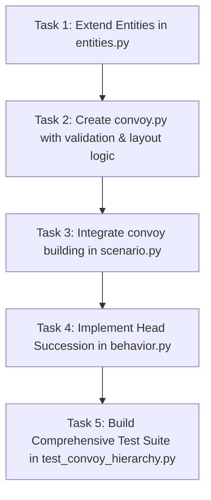

# Implementation Plan: Convoy Hierarchy (Issue #8)

This plan defines the implementation of **Issue #8: Convoy hierarchy of march units, serials and vehicle roles** in SandTable, based on U.S. Army doctrine (**ATP 4-11**, **ATP 4-16**, and **FM 3-90**) and the blueprint established in `doc/contested_logistics_one_pager.md`.

---

## 1. Architectural Principles & Tenets

1. **Opt-in & Byte-Identical**:
   - Any scenario where `scn.params.get("convoy")` is absent or `None` MUST run the exact existing code path, drawing the exact same RNG sequence, producing byte-identical metrics and traces.
2. **Structure-of-Arrays (SoA)**:
   - All hierarchy metadata is denormalized into parallel 1D NumPy arrays on the `Entities` dataclass.
3. **Contiguous Index Invariant**:
   - Every march unit occupies a contiguous run of entity indices ($[h, h + K - 1]$) so that existing chain-follow scans (`range(i - 1, ldr - 1, -1)`) and star-rank offsets ($i - \text{leader}[i]$) operate within the march unit.
4. **Doctrinal Enforcement at Build Time**:
   - Sizes outside doctrinal ranges must be rejected early with a descriptive `ValueError` naming the violated bounds.

---

## 2. Convoy Data Structures & Doctrine Bounds

### Doctrinal Constraints (ATP 4-11, G-7 & G-11)
| Dimension | Doctrinal Range | Reference Convoy Baseline |
|---|---|---|
| **March Unit Size ($K$)** | $1 \le K \le 25$ | 5 vehicles |
| **March Units per Serial ($M$)** | $2 \le M \le 5$ | 3 march units |
| **Serials per Column ($S$)** | $1 \le S \le 5$ | 1 serial |
| **Total Vehicles ($N$)** | $6 \le N \le 300$ | 15 vehicles ($1 \times 3 \times 5$) |

### Constants & Enumerations
To be defined in [`src/sandtable/convoy.py`](file:///Users/markfahim/Work/GRA%20GM/sandtable/src/sandtable/convoy.py) (and exposed where needed):

```python
# Convoy Sections (within a March Unit)
SECTION_NONE = -1
SECTION_HEAD = 0        # Pacesetter / Lead vehicle
SECTION_MAIN = 1        # Main body (cargo, troops, fuel)
SECTION_TRAIL = 2       # Trail element (recovery, medical, maintenance)

# Convoy Roles
ROLE_NONE = -1
ROLE_CONTROL = 0        # Command & control / pacesetter
ROLE_CARGO = 1          # Logistics / freight
ROLE_SECURITY = 2       # Armed escort / gun truck
ROLE_RECOVERY = 3       # Maintenance / wrecker / ambulance
```

### Scenario Configuration Schema (`scn.params["convoy"]`)
```json
{
  "convoy": {
    "march_unit_size": 5,
    "march_units_per_serial": 3,
    "serials_per_column": 1,
    "roles": ["control", "cargo", "cargo", "security", "recovery"]
  }
}
```

---

## 3. Step-by-Step Implementation Tasks



---

### Task 1: Extend `Entities` Dataclass
**Target File**: [`src/sandtable/entities.py`](file:///Users/markfahim/Work/GRA%20GM/sandtable/src/sandtable/entities.py)

1. Add optional attributes to `Entities` (defaulting to `None`):
   ```python
   march_unit: np.ndarray = None   # int16: march unit index (0, 1, 2, ...) or -1
   serial: np.ndarray = None       # int16: serial index (0, 1, ...) or -1
   section: np.ndarray = None      # int8: SECTION_HEAD, SECTION_MAIN, SECTION_TRAIL, or -1
   convoy_role: np.ndarray = None  # int8: ROLE_CONTROL, ROLE_CARGO, ROLE_SECURITY, ROLE_RECOVERY, or -1
   ```
2. In `__post_init__`, populate neutral defaults when `None`:
   ```python
   if self.march_unit is None:
       self.march_unit = np.full(n, -1, np.int16)
   if self.serial is None:
       self.serial = np.full(n, -1, np.int16)
   if self.section is None:
       self.section = np.full(n, -1, np.int8)
   if self.convoy_role is None:
       self.convoy_role = np.full(n, -1, np.int8)
   ```

---

### Task 2: Create Convoy Specification & Layout Engine
**Target File**: [`src/sandtable/convoy.py`](file:///Users/markfahim/Work/GRA%20GM/sandtable/src/sandtable/convoy.py)

1. **Validation (`validate_convoy_spec`)**:
   - Check doctrinal boundaries:
     - `1 <= march_unit_size <= 25` (Error: `"march unit size must be between 1 and 25, got {v}"`)
     - `2 <= march_units_per_serial <= 5` (Error: `"march units per serial must be between 2 and 5, got {v}"`)
     - `1 <= serials_per_column <= 5` (Error: `"serials per column must be between 1 and 5, got {v}"`)
     - `6 <= total <= 300` (Error: `"convoy total vehicles must be between 6 and 300, got {total}"`)
   - Check `roles` length matches `march_unit_size` if provided.

2. **Layout Builder (`build_convoy_layout`)**:
   - Generates the per-vehicle assignment:
     - `serial_idx = vehicle_idx // (march_unit_size * march_units_per_serial)`
     - `mu_idx = vehicle_idx // march_unit_size`
     - Position in MU $k = \text{vehicle\_idx} \pmod{\text{march\_unit\_size}}$
     - Section: $k = 0 \to \text{HEAD}$, $k = K - 1 \to \text{TRAIL}$, otherwise $\text{MAIN}$.
     - Convoy role: resolved from position role list.
     - Leader index: head of this vehicle's march unit ($\text{mu\_idx} \times K$). For $k=0$, `leader = -1`.

---

### Task 3: Hook into `build_entities` in `scenario.py`
**Target File**: [`src/sandtable/scenario.py`](file:///Users/markfahim/Work/GRA%20GM/sandtable/src/sandtable/scenario.py)

1. Check if `scn.params.get("convoy")` is present and non-empty.
2. If present for Blue ground forces:
   - Validate spec and build layout.
   - Assign `e.serial[i]`, `e.march_unit[i]`, `e.section[i]`, `e.convoy_role[i]`.
   - Set `e.role[i] = 0` (leader) for march unit heads, and `1` (follower) for others.
   - Set `e.leader[i] = -1` for heads, and `head_idx` for followers.
3. If absent:
   - Leave the existing logic completely intact (preserving byte-identity).

---

### Task 4: Command Succession on Head Loss
**Target File**: [`src/sandtable/behavior.py`](file:///Users/markfahim/Work/GRA%20GM/sandtable/src/sandtable/behavior.py)

1. In `_follow` or when determining leader positions:
   - If a vehicle's `leader[i]` is dead (`not ent.alive[ldr]`):
     - For convoy forces: find the earliest living vehicle in the same march unit:
       $$\text{new\_head} = \min \{ j \mid \text{ent.alive}[j] \land \text{ent.march\_unit}[j] == \text{ent.march\_unit}[i] \}$$
     - If found:
       - If $i == \text{new\_head}$: vehicle becomes the new head (`role[i] = 0`, `leader[i] = -1`).
       - If $i > \text{new\_head}$: vehicle follows `new\_head` (`leader[i] = new\_head`).
     - If no living vehicle remains in the march unit, revert to independent waypoint navigation.

---

### Task 5: Acceptance Test Suite
**Target File**: [`tests/test_convoy_hierarchy.py`](file:///Users/markfahim/Work/GRA%20GM/sandtable/tests/test_convoy_hierarchy.py)

The test suite will verify all acceptance criteria:
1. `test_off_is_byte_identical`:
   - Runs simulation seeds comparing `SC` without convoy params vs with `convoy=None`. Verifies exact byte-identical outputs.
2. `test_doctrinal_bounds`:
   - Validates that values outside doctrinal ranges raise `ValueError` naming the range.
3. `test_reference_convoy_layout`:
   - Builds 15-vehicle reference convoy ($1 \times 3 \times 5$).
   - Verifies exactly 3 march unit heads, contiguous index allocation, correct `section` (`HEAD`, `MAIN`, `TRAIL`), and role counts.
4. `test_leader_pointers_per_march_unit`:
   - Verifies each follower's `leader` points to the head of its own march unit, not to vehicle 0.
5. `test_head_loss_succession`:
   - Simulates killing the lead vehicle of a march unit and asserts that the next living vehicle succeeds to head.

---

## 4. Verification Execution Plan

Once you write the code, we will execute the following commands to confirm stability:
```bash
# 1. Run the new convoy test suite
pytest tests/test_convoy_hierarchy.py -v

# 2. Run full regression test suite (ensure nothing broke)
pytest tests/ -q
```
