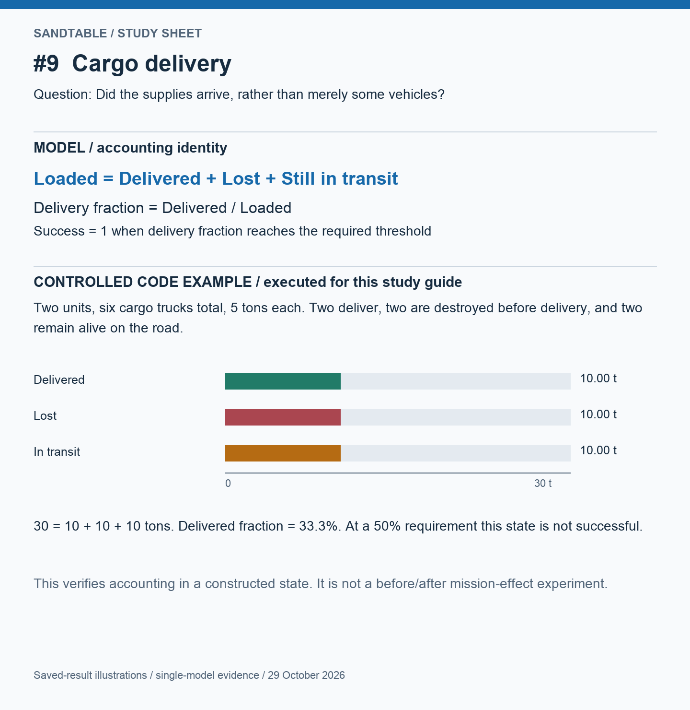
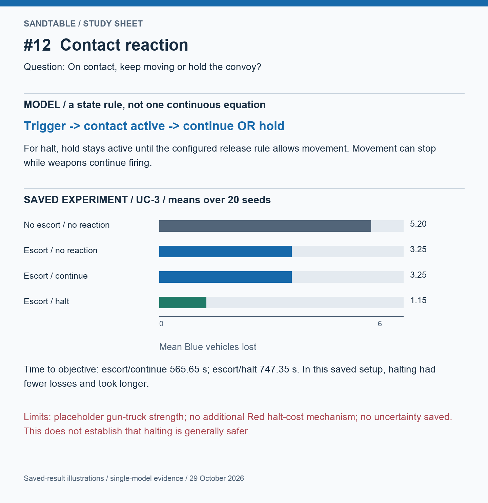
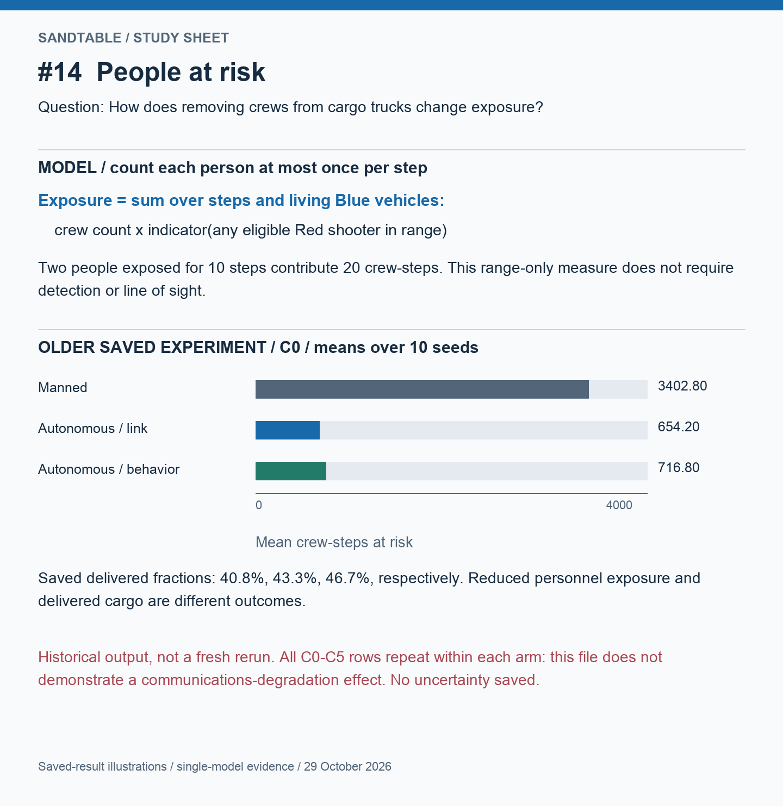
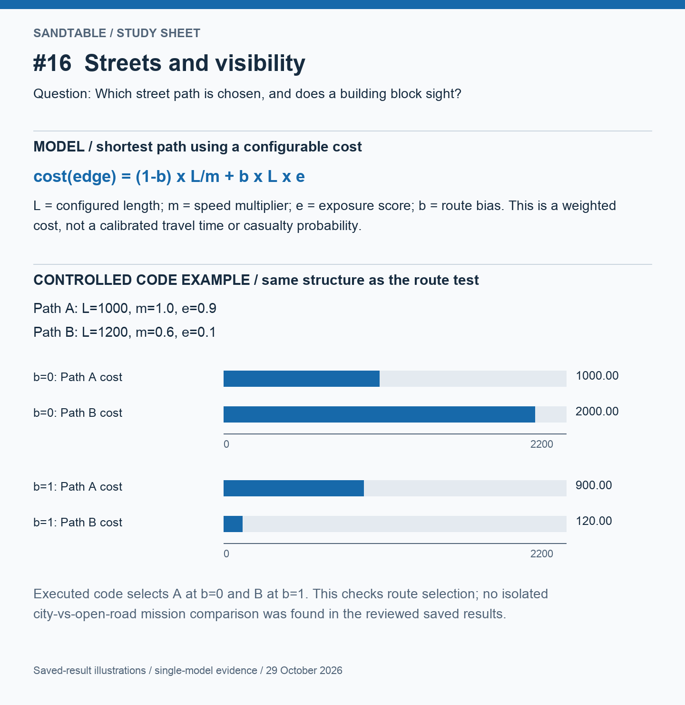
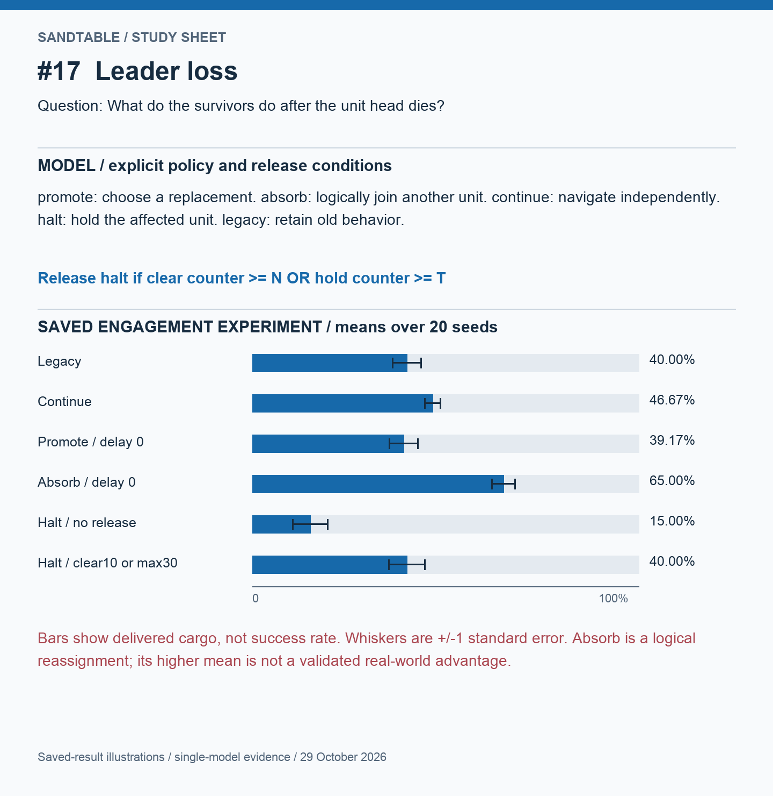
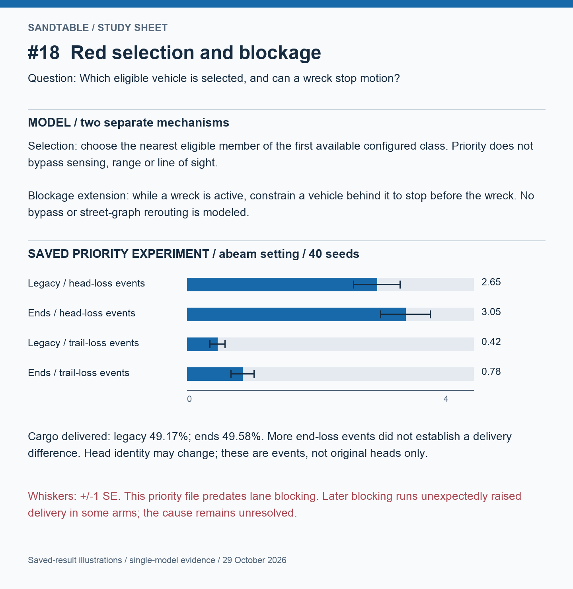
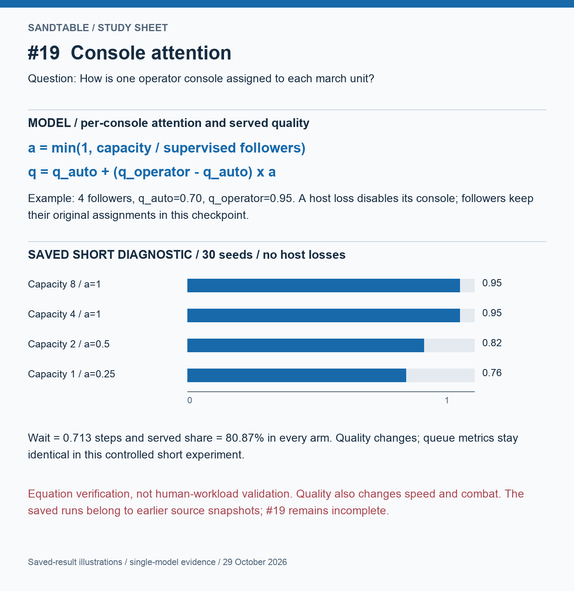
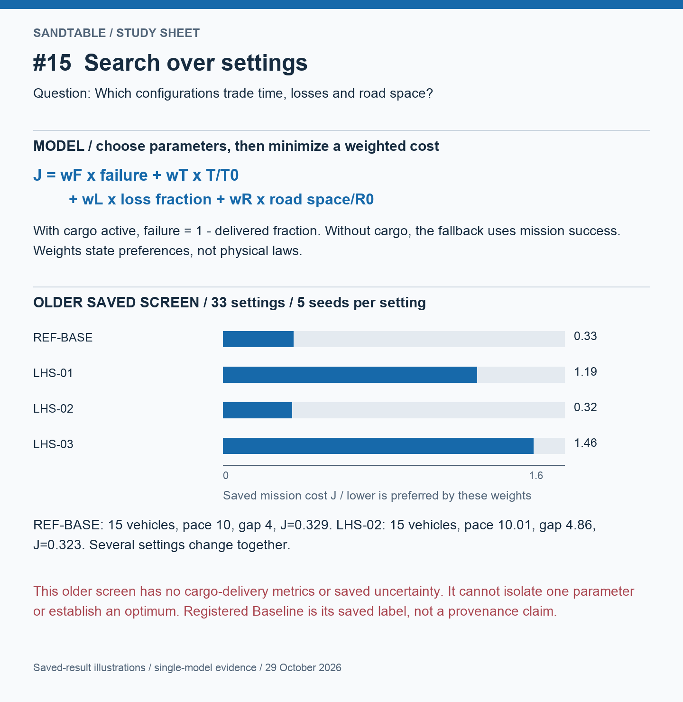

# Convoy simulator: mathematics and results, one issue at a time

Prepared 29 October 2026 from the local source and saved JSON outputs. This guide does not rerun the mission experiments or validate their historical source revisions. The current inspected checkout is `issue-19-convoy-console-per-unit` at `a799771`; #18 source was inspected read-only from its separate branch. No repository files were changed.

**Three different kinds of evidence:**

1. **Worked example:** selected numbers that make a formula understandable.
2. **Controlled code example/test:** verifies a specific implementation rule, not realism.
3. **Saved experiment:** an output from a particular scenario, assumptions and source version. A larger bar is not automatically a scientifically established advantage.

Read in this order: **#9 → #12 → #14 → #16 → #17 → #18 → #19 → #15**. #8/#10/#11/#13 are the foundation you already understand; their formulas appear at the end for reference.

## A small dictionary for the mathematics

| Symbol | Read it as |
|---|---|
| i | One vehicle's index |
| k | One simulation step |
| Δt | Seconds per step |
| Σ | Add up the listed quantities |
| 1[condition] | 1 if the condition is true, otherwise 0 |
| min(a,b) | Choose the smaller value |
| max(a,b) | Choose the larger value |
| argmin | Choose the item with the smallest value |
| fraction | A number from 0 to 1; multiply by 100 for percent |
| mean | Average across simulation runs |
| SE | Standard error of an estimated mean; not variation of one vehicle |

## #9 — What does a successful delivery mean?

**Problem:** vehicle survival is not cargo delivery. An escort reaching the destination cannot replace destroyed supplies.

For vehicle i, define c_i as its originally loaded cargo in tons, d_i as cargo already delivered, and a_i as 1 if it is alive and 0 otherwise. The current code computes:

```text
L = Σ c_i                          originally loaded
D = Σ d_i                          delivered
X = Σ (1-a_i)(c_i-d_i)              lost before delivery
I = Σ a_i(c_i-d_i)                  alive but not yet delivered

L = D + X + I                      conservation of cargo
f = D/L                            delivered fraction
success = 1[f >= required_fraction]
throughput = D / elapsed_time       tons per second
```

A truck destroyed after unloading does not destroy cargo it already delivered. A living stopped truck has cargo **in transit**, not automatically lost. Arrival inside the goal radius marks cargo delivered; no unloading duration is modeled here. The simulation may stop at the required threshold, so 50% delivered can be a successful run if the requirement is 50%.

**Executed code example:** two units, six cargo trucks carrying 5 tons each. We constructed a state where two delivered, two were destroyed, and two remain on the road. `metrics.compute` returned loaded 30, delivered 10, lost 10, in transit 10 tons; delivered fraction 0.3333; throughput 0.1 ton/s at 100 seconds; cargo success 0 for a 50% requirement. This is direct accounting verification, not a new mission experiment.



**Source:** `src/sandtable/metrics.py::_cargo_delivery_metrics`, `sim.py`; fixture structure from `tests/test_convoy_cargo_delivery.py`. No standalone #9 before/after mission result was found among the reviewed saved outputs. Cargo becomes the outcome measured in later experiments.

## #12 — What does the convoy do on contact?

**Problem:** the model needs an explicit reaction when vehicles receive fire, a head is lost, or a detected enemy meets the configured range condition.

This is mainly a **state machine**, not a continuous physical equation. Let u_k indicate whether any configured trigger occurred at step k, and k_last be the latest trigger step. For the timeout release:

```text
contact_k = u_k OR
            (contact_(k-1) AND (k-k_last)Δt < clear_seconds)

hold_i,k = 1 when contact is active, action is halt,
           and vehicle i belongs to the configured halt scope
```

Holding freezes the movement target at the vehicle's current position; firing can continue. `continue` observes contact without issuing that movement hold. The initial implemented increment does not implement herringbone/disperse. Escorts can use a separately configured security platform; assigning a security label alone should not be confused with giving a vehicle a stronger weapon.

**Saved UC-3 experiment, 20 seeds:**

| Arrangement | Mean Blue losses | Mean time to objective, seconds | Success frequency |
|---|---:|---:|---:|
| No escorts, no reaction | 5.20 | 636.70 | 90% |
| Escorts, no reaction | 3.25 | 565.65 | 95% |
| Escorts, continue | 3.25 | 565.65 | 95% |
| Escorts, halt | 1.15 | 747.35 | 100% |



**Interpretation:** in this setup halt has fewer losses and takes longer than continue. No uncertainty was stored, gun-truck strength is a placeholder, and Red has no added mechanism to exploit a halted convoy. Do not conclude that stopping is generally safer. The base scenario has no cargo configured, so its success field must not be relabeled cargo-delivery success.

**Result file:** `report/viz/contact_arms.json`. **Model:** `behavior.py::_update_contact`; tool: `tools/make_contact_arms.py`.

## #14 — How many people are exposed?

**Problem:** fifteen vehicles can carry very different numbers of humans depending on autonomy.

Define the eligible shooter set R_k as living Red entities with positive weapon range and positive base lethality. For each living crewed Blue vehicle:

```text
z_i,k = 1[there exists r in R_k with distance(i,r) <= range_r]
E = Σ_k Σ_i alive_i,k × crew_i × z_i,k
```

E is **crew-steps**. Multiplying by Δt converts to crew-seconds. The `there exists` condition ensures one crew is counted once per step, not again for every overlapping shooter. No detection or LOS is required. The current crew-loss metric assumes vehicle destruction loses its full crew; it is not a casualty-injury simulation.

**Worked example:** one control vehicle with two people plus four cargo trucks. Manned cargo trucks have two people each: 10 people total. Unmanned cargo trucks have zero: 2 people total. If all vehicles have exactly 100 exposed steps, the totals are 1000 versus 200 crew-steps. That difference is arithmetic under the chosen crew assignments, not proof of better mission performance.

**Older saved experiment, C0, 10 seeds:**

| Arm | Mean crew-steps at risk | Mean delivered fraction | Success frequency |
|---|---:|---:|---:|
| Manned | 3402.8 | 40.83% | 70% |
| Autonomous link | 654.2 | 43.33% | 50% |
| Autonomous behavior | 716.8 | 46.67% | 80% |



**Important:** all C0–C5 values repeat exactly within each arm in this saved file. It does not demonstrate sensitivity to communication degradation. Its headless policy is also explicitly labeled a placeholder predating the #17 experiments. No standard errors are saved. Different success frequency and average delivery can coexist: success is a threshold per run, while delivered fraction is averaged across runs.

**Result file:** `report/viz/autonomy_arms.json`. **Model:** `metrics.py::accumulate_crew_at_risk`, `crew_metrics`; configuration: `convoy.py`.

## #16 — Which street path, and what is visible?

**Problem:** the convoy needs route choices, while buildings should obstruct some sensing and direct-fire paths.

The graph model assigns each edge a length L, dimensionless speed multiplier m, and configured exposure score e. With route bias b in [0,1]:

```text
cost(edge) = (1-b)(L/m) + b(L×e)
chosen path = argmin over paths Σ cost(edge)
```

This is the implemented weighted cost. Because m is a multiplier, L/m is not physical travel time in seconds without a reference speed. Likewise e is not an observed casualty probability. The weight b expresses a model preference.

**Executed controlled code example:** path A has total L=1000, m=1, e=0.9; path B has L=1200, m=0.6, e=0.1. At b=0 the costs are 1000 and 2000, and code selects A. At b=1 the costs are 900 and 120, and code selects B. Configured lengths here follow the test fixture and are not inferred from the schematic node coordinates.

Visibility is a separate rule:

```text
LOS(i,j) = 1 if the sampled ray between i and j crosses no building cell
```

When the relevant subsystem applies LOS, an intervening building can prevent detection or engagement. This does not change #14's range-only exposure formula, which deliberately has no LOS factor.



**Result status:** route-choice and LOS tests exist; no isolated city-vs-open-road mission comparison was found among the reviewed saved outputs. A passing routing example is not evidence that cities reduce casualties.

**Model:** `street_graph.py::edge_cost/find_path`, `world.py::los`; tests: `tests/test_convoy_street_graph.py`.

## #17 — What follows leader loss?

**Problem:** the survivors need a defined response after the head dies. There is no single universal equation for this; it is a set of policy transitions.

| Policy | Rule |
|---|---|
| legacy | Preserve the earlier code path |
| promote | Select an eligible living replacement, after optional delay |
| absorb | Logically attach survivors to a nearby eligible unit in the same serial |
| continue | Survivors navigate independently |
| halt | Hold the affected unit until its release condition |

For a halted unit, let c_k count consecutive clear steps and h_k count held steps:

```text
c_k = 0 if an eligible shooter is in range; otherwise c_(k-1)+1
h_k = h_(k-1)+1
release = (c_k >= N) OR (h_k >= T)     for configured N/T
```

The clear test uses ground truth, not what Blue knows. With neither release condition, a halt can persist to mission end. A time-based limit can release the unit while a threat remains. `leaderless_steps` sums unit-steps, not vehicle-steps; the halt metric counts held vehicle-steps. Convert each to seconds with Δt while retaining its population unit.

**Saved natural-engagement experiment, 20 seeds:**

| Policy | Mean delivered cargo | Mean cargo still in transit, tons |
|---|---:|---:|
| legacy | 40.00% | 4.50 |
| continue | 46.67% | 4.00 |
| promote, zero delay | 39.17% | 4.25 |
| absorb, zero delay | 65.00% | 5.75 |
| halt, no release | 15.00% | 15.75 |
| halt, clear10 OR max30 | 40.00% | 6.75 |



**Interpretation:** indefinite halt strands cargo. Absorb has a higher mean here, but logical reassignment can itself create model effects; this is not a validated real-world recommendation. These are selected arms from one experiment, not all delays or a policy ranking. The separate forced-kill experiment must not be averaged into the natural-engagement experiment.

**Result file:** `report/viz/leader_loss_arms.json`. **Model:** `behavior.py::_update_leader_loss`.

## #18 — How do selection and physical blockage change outcomes?

**Problem:** choosing which vehicle is engaged and blocking the road after destruction are separate mechanisms.

For Red shooter r, form eligible target set A_r using the existing alive, seen, range, LOS, domain and applicable ammunition rules. Let C_1, C_2, ... be configured priority classes:

```text
j = first class for which A_r intersects C_j
target = nearest eligible target in that intersection
if no class matches: nearest target in A_r
```

Priority changes selection, not a weapon's lethality. Some classes use ground-truth roles; they are not a validated recognition model. The ambush template adds activation and fire-control stages, not Red movement.

The later lane-block extension adds a route constraint. For a vehicle behind an active wreck at coordinate s_w and stand-off d:

```text
do not advance beyond s_w - d while the blockage is active
```

Actual membership also depends on configured lane width and wreck-role filters. The clearing duration is a placeholder parameter, not a simulated repair crew. There is no bypass or street-graph rerouting. Physical blockage does not clear a contact halt or leader-loss halt.

**Saved priority experiment, abeam setting, 40 seeds:**

| Measure | Legacy nearest | Ends priority |
|---|---:|---:|
| Mean head-destruction events | 2.65 | 3.05 |
| Mean trail-destruction events | 0.425 | 0.775 |
| Mean delivered fraction | 49.17% | 49.58% |

Head/trail identities may change; event counts are not restricted to the originally assigned vehicles. The adjusted analysis supports differences in the end-loss events in this setup; it does not establish a cargo-delivery difference.



**Separate later evidence:** some blocking arms unexpectedly had higher delivery. Disabling scripted withdrawal did not explain the increase. Its cause remains unresolved. Do not merge the pre-blockage priority results and later blockage runs into one experiment. The halt-cost mechanism, equivalence-margin definition and other required decisions remain open.

**Results:** `red_priority_arms.json`, `lane_block_arms.json`, `withdrawal_diagnostic.json`. **Source:** separate #18 branch, `target_priority.py`, `ambush.py`, `lane_block.py`.

## #19 — How does each console serve its unit?

**Problem:** the legacy attention denominator counts all Blue entities; the new mode assigns each unit's crewless followers to its hosted console.

Let n_c be assigned followers, or currently living followers when that basis is selected; K is the configured capacity:

```text
a_c = min(1, K/n_c), or 1 if n_c=0
q_c = q_auto + (q_operator-q_auto) a_c
```

For 4 followers, q_auto=.70 and q_operator=.95:

| K | Attention | Served quality |
|---:|---:|---:|
| 8 | 1 | .9500 |
| 4 | 1 | .9500 |
| 2 | .5 | .8250 |
| 1 | .25 | .7625 |

**Saved short diagnostic, 30 seeds:** the observed attention and quality match those values. Mean queue wait is 0.7128 steps and served share is 0.8087 in every arm. Changing attention changes quality; it does not directly change service time or queue wait in the equation.



Requests have distinct components: uplink delay → queue wait WT → interaction/service IT → downlink delay. Console availability and link drops affect whether a request is answered. The issue's neglect margin is:

```text
M = NT - (s-1)(IT+WT)
```

NT is the mean completed interval from an answer to the next request. s is the reported mean living supervised count. M<0 violates the configured inequality for these estimates; averages do not prove every console satisfies it, and interrupted intervals introduce potential selection bias. Registered values remain unspecified.

**Critical interpretation:** quality also scales speed by 0.35+0.65q and enters combat probabilities. It is not a pure human decision score. Exempt crewed vehicles retain quality 1.0. A dead host disables its console; ownership stays fixed even after absorption. Those are unresolved assumptions. More consoles and stronger links do not automatically isolate an attention effect.

**Result files:** `attention_diagnostic_short.json`, `assignment_diagnostic.json`, `console_arms.json`. The latter shows served share falling from 82.07% at C0 to 0% at C5, while delivered fraction falls from 29.72% to 8.06%; delivery is not strictly monotone (C4=7.78%). These are model-specific settings, not universal link grades. The original attention diagnostic had shared-RNG coupling; the short design is a disclosed redesign. #19 remains an incomplete checkpoint.

## #15 — How are configurations compared?

**Problem:** instead of hand-selecting one speed/gap/escort arrangement, evaluate many configurations and combine outcomes with explicit preferences.

Define a parameter vector θ=(pace, time gap, element gap, unit size, security allocation, ...). For each θ, run the same chosen seed set and estimate mean outcomes. The current cost supports:

```text
J(θ) = wF × failure + wT × T/T0 + wL × loss_fraction + wR × road_space/R0
failure = 1-delivered_fraction when cargo metrics exist
          1-success_rate otherwise
```

Lower J is preferred only under the stated weights. T0 and R0 make different units comparable. This is a chosen objective, not doctrine or a physical law. A parameter search does not itself establish causality.

**Older saved screen:** 32 sampled configurations plus one reference; five seeds per configuration. The saved tool uses wF=1, wT=.3, wL=.5, wR=.2, T0=1800 s, R0=2000 m. It uses mission success, not cargo delivery, in its cost.

| Setting | Vehicles | Pace | Time gap | Saved cost J |
|---|---:|---:|---:|---:|
| REF-BASE | 15 | 10.00 | 4.00 | .329 |
| LHS-01 | 9 | 11.06 | 7.17 | 1.191 |
| LHS-02 | 15 | 10.01 | 4.86 | .323 |
| LHS-03 | 15 | 6.66 | 2.20 | 1.455 |



Several settings change at once, including force size and security allocation; no uncertainty is stored. The tiny reference-versus-LHS-02 gap is not established as meaningful. This screen illustrates searching, not a proven optimum. Its label “Registered Baseline” is quoted from the saved file and does not independently establish preregistration.

**Result file:** `report/viz/convoy_sweep_data.json`; model: `opt_metrics.py::MissionScoreMetric`; historical screening tool: `tools/make_convoy_sweep.py`.

## Foundations you already understand: #8, #10, #11, #13

### #8: hierarchy

With K vehicles per unit, M units per serial and S serials, N=KMS. Integer division and remainders assign each vehicle a unit, serial and local position. Section (position) and role (job) are separate. This constructs organization; it is not an effectiveness experiment.

### #10: pace and gap

`desired_gap = max(minimum_gap, tracked_speed × time_gap)`. Pacesetters have a configured speed cap while followers can catch up. This is a simplified target-spacing rule; do not automatically equate target reference-point distance with bumper gap.

### #11: planning arithmetic

`CL = sum(vehicle lengths)+sum(gaps)`; `RS=CL(1+safety_fraction)`; `PT=CL/v`; `TD=distance/v`; `RCT=TD+PT`. These are planning calculations under their assumptions, not guaranteed empirical arrival times after contact.

### #13: route stationing

For route vertices p_j: segment length ℓ_j=||p_(j+1)-p_j|| and cumulative length S_j=Σ_(h<j)ℓ_h. Within segment j:

```text
p(s) = p_j + ((s-S_j)/ℓ_j)(p_(j+1)-p_j)
follower target: s* = s_reference - rank × desired_gap
```

**Worked corner example:** route (0,0)→(100,0)→(100,100). A leader at s=120 is at (100,20). A target 40 route-meters behind is s=80, at (80,0), on the previous segment. A naive point 40 meters behind the leader's northward heading is (100,-20), outside this route. Stationing fixes target placement, not every detail of steering dynamics.

## What can and cannot be compared

- Do not place #12's arrival-based success beside #14's cargo-success rate as if they were the same outcome.
- Do not compare absolute crew-step totals across different durations and force sizes without acknowledging both.
- Some experiments stop when a delivery threshold is reached; their delivered fraction is not the fraction that would eventually arrive if the mission continued.
- A saved result is not a fresh result on the currently checked-out branch. The branch does not include #18, but its historical output files are still present.
- No new long mission sweeps or full test suites were run for this guide. Only the explicit cargo accounting and street routing examples were executed directly.
- Source paths and SHA-256 hashes of plotted result files are saved in `result-sources.json`. Hashes identify the bytes read, not the original generating code's validity.

## How to study this without getting lost

For each issue, answer four questions in this order:

1. What input or behavior changed?
2. Which equation or rule implements the change?
3. Which output should reveal the effect?
4. Does the saved evidence verify the rule, estimate a mission effect, or leave the effect unknown?

Start with #9 and reproduce 30=10+10+10. Then #14: calculate 2 people × 10 exposed steps. Only then move to #17/#18/#19, which combine state changes and assumptions rather than one formula.
